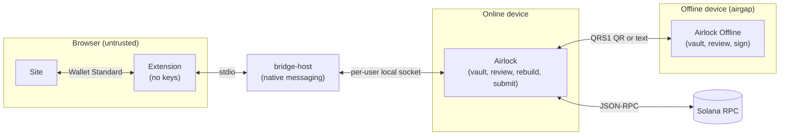
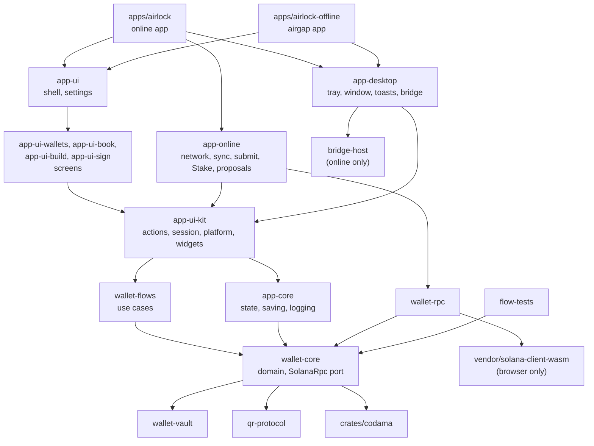

# Airlock

A Solana wallet that keeps preparing a transaction apart from signing it. An online device builds, reviews and submits. Another device, which may never connect to a network, reviews the same transaction on its own and signs it. Transactions and signatures move between the two as QR codes or pasted text. The same Dioxus app runs on the desktop and in a browser, and can play either role. Keys are kept in a password-sealed vault. On desktop, a browser extension can forward a site's request to the app, so the site gets a normal Wallet Standard wallet while the keys stay in the app.

**Not ready for production, and not formally audited.** This is a prototype that handles private keys and signs transactions. Do not use it to hold or move real funds. Read the [disclaimer](#disclaimer) first.

## Scope

- **Solana transactions:** browser requests and Sign-screen paste accept legacy, v0 and v1. A hot-only request can be signed as is; anything else is converted to v1 (wire prefix `0x81`, SIMD-0385). The QR handoff (QRS1) stays v1 only; scanning a non-v1 QR is refused.
- **Wallet kinds:** hot (private key or seed phrase), offline (the key is on another device), Ed25519 programmatic signer, and Squads multisig (v4 and smart account). Hardware wallets are not supported yet.
- **Two builds:** the online app, and `airlock-offline`, which links no network code: it opens no connection, and cannot simulate or submit.
- **Browser bridge:** desktop only. It answers `connect` and `signTransaction` with one to 16 transactions, which go back together. Every other method returns `not_implemented`.

How each kind of wallet signs, from the app and from a site, is in [docs/signing.md](docs/signing.md).

## The apps

Four things run, on up to two devices and a browser:

| App | Where it runs | What it does |
| --- | --- | --- |
| **Airlock** (`apps/airlock`) | Desktop or browser, online | Holds a vault, builds, reviews, rebuilds and submits transactions, and answers the browser extension (desktop only) |
| **Airlock Offline** (`apps/airlock-offline`) | Desktop, offline | Holds its own vault, reviews and signs. It links no network code, so it cannot simulate or submit |
| **Airlock Extension** (`extension`) | The browser | Shows sites a Wallet Standard wallet and forwards their requests. It holds no keys and approves nothing |
| **bridge-host** (`crates/bridge-host`) | Started by the browser | Relays between the extension and the running desktop app |



A transaction starts on the online app: built there, or sent by a site through the extension and `bridge-host`. The online app reviews it and signs with its own keys. For a key on the offline device, it shows the transaction as QR codes (or text to paste). The offline app reads them, reviews the transaction on its own and signs, and its signatures go back the same way. The online app then submits, or returns the signed transaction to the site.

The site, the extension and the browser are trusted for nothing except reporting the origin. The online app decides for its own keys. For a key on the offline device, the offline app decides from its own reading of the transaction. The bridge's threat model is in [docs/browser-bridge.md](docs/browser-bridge.md).

## Running it

**Prerequisites:**

- Rust through `rustup`. `rust-toolchain.toml` pins the compiler and the wasm target, and `rustup` installs them on first use.
- The Dioxus CLI at the version releases use: `cargo binstall dioxus-cli@0.7.10` (or `cargo install dioxus-cli@0.7.10`).
- On Windows, a WebView2 runtime, which recent Windows already has.
- For the extension, Node 22.

Run the apps through `dx`, not plain `cargo run` or `cargo build`: `dx` collects the assets the WebView loads.

### Airlock (online)

```bash
dx serve -p airlock --desktop                 # desktop
dx serve -p airlock --web --addr 0.0.0.0      # web, at http://127.0.0.1:8080
```

The camera works on `localhost`, but browsers block it on a plain-HTTP LAN address. To scan from a phone on the LAN: set `[web.https] enabled = true` in `apps/airlock/Dioxus.toml`, run `scripts/gen-dev-cert.ps1`, restart the web server and accept the certificate warning. On macOS, run the desktop app through `dx` (it writes the camera permission into `Info.plist`) and allow the camera under System Settings → Privacy & Security → Camera if asked. On Windows, restart `dx serve` fully after changing the WebView2 camera flags.

### Airlock Offline

```bash
dx serve -p airlock-offline --desktop
```

It keeps its own data folder (`airlock-offline`), so both apps can run on one machine with different vaults.

### Extension and bridge-host (desktop only)

```bash
cd extension && npm install && npm run build && cd ..
cargo run -p bridge-host -- install
```

1. Load `extension/dist` as an unpacked extension in a Chromium browser (Chrome, Edge, Brave).
2. `install` registers `bridge-host` with the browsers for the current user. Run it again if the binary moves; `bridge-host uninstall` removes it.
3. Restart the browser, then start Airlock on the desktop, unlock it and set it to Online.

`extension/demo.html` is a test page; details and the message format are in [docs/browser-bridge.md](docs/browser-bridge.md).

### Installers

```bash
dx bundle -p airlock --release --desktop --features bundle                          # portable folder
dx bundle -p airlock --release --desktop --features bundle --package-types nsis     # Windows installer (or msi, with WiX)
dx bundle -p airlock-offline --release --desktop --features bundle --package-types nsis
```

Output is under `target/dx/<app>/bundle/`. `--features bundle` hides the console window on Windows. The target PC still needs WebView2. Releases are built by CI from a tag; see [docs/releasing.md](docs/releasing.md).

### Tests

```bash
# every crate except flow-tests and the vendored RPC client
cargo test --workspace --exclude flow-tests --exclude solana-client-wasm

# flow-tests: built transactions against the real programs in an in-process VM (LiteSVM).
# The program binaries are downloaded from devnet and checked against pinned hashes.
node scripts/fetch-programs.mjs
cargo test -p flow-tests

# the extension
cd extension && npm test && npm run check
```

## The code



The two apps are thin: each picks its tabs and services and hands them to the shared shell in `app-ui`. Only the online app links `app-online` and `wallet-rpc`, so only it talks to a node.

A screen collects input and shows state. To do something, it calls an action in `app-ui-kit` (or in `app-online`, for Stake and proposals), which reads the session, calls one use case in `wallet-flows`, and writes the result back to the vault, a form or the Sign screen. The screen crates do not talk to a node themselves. Every transaction, whatever screen or request it came from, is signed on the Sign screen (`Session::open_in_sign`).

- `wallet-core` is the domain: address book, keys, transactions, IDLs, wallet kinds, and the review of a transaction before it is signed. It defines the `SolanaRpc` port and opens no socket.
- `wallet-flows` holds the use cases. Each takes a `SolanaRpc` and plain data, and returns plain data, so it runs the same behind a screen and against the fake node in its tests.
- `wallet-rpc` implements `SolanaRpc` and is the only crate that talks to a node: Agave's `solana-client` on desktop, the vendored `solana-client-wasm` in a browser.
- `wallet-vault` seals whatever document it is given (Argon2id, then XChaCha20-Poly1305) and wipes secrets. It does not know what a wallet is.
- `qr-protocol` is the QRS1 format. It knows bytes, not Solana.
- `qr-codec` draws and reads QR codes, with no dependencies. `qr-codec-wasm` builds its scanner into the WebAssembly module the camera loop runs.
- `flow-tests` runs transactions built by `wallet-core` against the real on-chain programs in an in-process VM.

QRS1 carries a payload of one to 64 typed objects, written with wincode, as one QR code or a numbered set of codes of the same size: a transaction, its signatures, a context note that lists the IDLs it was read with, or any of them together, and also wallet keys and Vector key rotations. [docs/signing.md](docs/signing.md#the-pipeline) lists the kinds. A reader accepts the payload only when every frame is present and the CRC matches. The frame layout is documented on the `qr-protocol` crate.

### Layout

| Path | What it is |
| --- | --- |
| `apps/airlock` | The online app (desktop and web), with its `Dioxus.toml` and icons |
| `apps/airlock-offline` | The airgap desktop app, which links no network code |
| `crates/app-ui` | The shared shell: navigation, settings, notices and toasts |
| `crates/app-ui-wallets`, `app-ui-book`, `app-ui-build`, `app-ui-sign` | Screens: wallets; address book and programs; build; sign and QR transfer |
| `crates/app-ui-kit` | Actions, the session and each screen's form, platform glue (files, camera, QR drawing), CSS and shared widgets such as the lock dialog |
| `crates/app-online` | The node monitor, balance sync, submitting and tracking, and the Portfolio, Stake and proposals screens |
| `crates/app-desktop` | Desktop services: tray, window, OS toasts, and the browser bridge listener and request modals |
| `crates/app-core` | The app's state, saving and logging, with no UI and no network |
| `crates/wallet-core` | Domain. Groups: `book`, `keys`, `tx`, `idl`, `wallets`, `review`, `edit` (a transaction read back into Build's blocks), `transport` |
| `crates/wallet-flows` | Use cases: refresh, compile, simulate, send, stake, Squads, programmatic signers, Vector wallets, rebuilds for wallets without a key |
| `crates/wallet-rpc` | The node client, and the WebSocket feed of wallet activity |
| `crates/tokens-api` | Prices and token checks from the Tokens API, for the Portfolio |
| `crates/wallet-vault` | Password seal, secret wiping, and stores |
| `crates/qr-protocol` | QRS1 frames |
| `crates/qr-codec`, `qr-codec-wasm` | The QR encoder and camera decoder, and the WebAssembly module built from it (see its [README](crates/qr-codec/README.md)) |
| `crates/bridge-protocol` | The bridge's framing and message shapes, shared by the app and `bridge-host` |
| `crates/bridge-host` | Native messaging host for the extension |
| `crates/flow-tests` | Transactions and use cases run in an in-process Solana VM (programmatic, Vector, Squads, …) |
| `crates/codama` | The Codama dynamic client: reads IDLs, builds and explains instructions, for `wallet-core` (see its [README](crates/codama/README.md)) |
| `extension` | The browser extension |
| `vendor/solana-client-wasm` | The browser RPC client |

## Documentation

| Document | What it covers |
| --- | --- |
| [docs/signing.md](docs/signing.md) | How each wallet kind signs, starting in the app or from a site |
| [docs/browser-bridge.md](docs/browser-bridge.md) | The extension, `bridge-host` and the desktop listener, the message format and the threat model |
| [docs/architecture.md](docs/architecture.md) | The two builds, the core that outlives the window, logging, and where new work goes |
| [docs/vector-fork.md](docs/vector-fork.md) | The Vector program fork and deployment, how to rebase it, and the decisions and risks behind Vector wallets |
| [docs/idls.md](docs/idls.md) | How IDLs read and build instructions, and the rules that tie what is shown to what is signed |
| [docs/design-system.md](docs/design-system.md) | Tokens and components shared by the app and the extension popup |
| [docs/releasing.md](docs/releasing.md) | Tagging, building and publishing a release |

## License

MIT. See [LICENSE](LICENSE).

The vendored RPC client under `vendor/solana-client-wasm` is Apache-2.0; see `vendor/ORIGIN.md`. The IDL files under `crates/wallet-core/idls` are copied from their programs' repositories (`solana-program`, Squads, Vector, Raydium) and keep their own licenses.

## Disclaimer

THE SOFTWARE IS PROVIDED "AS IS", WITHOUT WARRANTY OF ANY KIND, EXPRESS OR
IMPLIED, INCLUDING BUT NOT LIMITED TO THE WARRANTIES OF MERCHANTABILITY,
FITNESS FOR A PARTICULAR PURPOSE, AND NONINFRINGEMENT. IN NO EVENT SHALL THE
AUTHORS OR CONTRIBUTORS BE LIABLE FOR ANY CLAIM, DAMAGES, OR OTHER LIABILITY,
WHETHER IN AN ACTION OF CONTRACT, TORT, OR OTHERWISE, ARISING FROM, OUT OF, OR
IN CONNECTION WITH THE SOFTWARE OR THE USE OR OTHER DEALINGS IN THE SOFTWARE.

Use at your own risk. This code has not been formally audited. You — not the
authors — are responsible for any loss of funds, keys, or data resulting from
its use, misuse, or integration into other systems.
