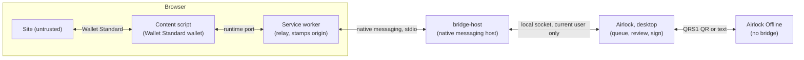

# Browser bridge

How a site reaches Airlock: a browser extension that holds no keys, a native messaging host, and the online desktop app, which reviews and signs. How each kind of wallet signs a site's request is in [signing.md](signing.md#flows-that-start-in-a-browser).

The bridge answers `status`, `connect`, `disconnect` and `signTransaction` with one to 16 transactions (legacy, v0 or v1), which go back together once every one is signed. Every other method returns `not_implemented`. It is desktop only, and only in the online app: Airlock Offline does not link it.

## Components



### Extension

Manifest V3, TypeScript, in `extension/`.

- A content script registers a wallet named Airlock with `@wallet-standard/wallet`, so sites using `@solana/wallet-adapter` or the Wallet Standard find it without a `window.solana` injection. It advertises `standard:connect`, `standard:disconnect`, `standard:events`, `solana:signTransaction`, `solana:signAndSendTransaction` and `solana:signAndSendAllTransactions` (versions legacy, 0 and 1, the same for all three), `solana:signMessage` and `solana:signIn` (version 1.0.0): only what the desktop app can do, so a site never picks a feature that is certain to fail. An account lists `solana:signMessage` only when a key on the device signs as it.
- `signTransaction` with several inputs, which is how the wallet adapter's `signAllTransactions` reaches a Wallet Standard wallet, is one request with every transaction in it, at most 16 (`MAX_TRANSACTIONS` in `protocol.ts` and `bridge_protocol`). The outputs come back in the order of the inputs.
- The service worker relays page requests to `chrome.runtime.connectNative("dev.airlock.bridge")`. It sets each request's `origin` from the browser's `sender`, never from page data, and turns away a page with no origin of its own, such as a sandboxed frame, whatever its URL says. It gives each request an id of its own, so a reply can only reach the page that asked, and the request code is not the page's to choose. Its `expiresAt` is ten minutes ahead for a request that waits for the user, and 15 seconds for any other. Past those it applies the [limits](#limits).
- When a page closes, the service worker sends `cancel` for each of its requests still waiting for the user.
- The content script answers `no_user_gesture` to a `connect` that is not silent, and to a `signIn`, from a page nobody has used yet (`navigator.userActivation.hasBeenActive`). It reads that in its own world, where the page's script cannot change it. A site that is already connected can still ask for a signature from a page that was just loaded.
- The popup lists pending requests by their request code (below), and says whether the host is missing or the app is not running.

### bridge-host

A small Rust binary (`crates/bridge-host`) that the browser starts and talks to over stdin and stdout. It forwards each frame to the running desktop app over a local socket, and answers `app_not_running` when nothing listens, so the next request tries again. Once connected it exits as soon as the browser or the app goes away, or it reads a frame it cannot make sense of. The browser then tells whoever was waiting, and starts a new host for the next request. It logs to `<data dir>/logs/bridge-host.YYYY-MM-DD.log`; its stdout carries native messaging only.

| Command | What it does |
| --- | --- |
| `bridge-host install` | Registers the host for the current user |
| `bridge-host uninstall` | Removes that registration |
| `bridge-host listen` | A development stand-in for the app: answers `status`, rejects everything else. Quit it before starting the app, which needs the same socket |

#### Registration

`install` writes one manifest for Chromium browsers, whose `allowed_origins` pins the extension id, and one for Firefox, whose `allowed_extensions` pins `bridge@airlock.dev`. Both point at the `bridge-host` binary that ran `install`, so run it again after moving the binary. It is a separate opt-in step, not part of the app installer, so an offline machine never has it.

On Windows the manifests go to `%LOCALAPPDATA%\airlock\native-messaging\`, and a registry key per browser names them:

- Chrome: `HKCU\Software\Google\Chrome\NativeMessagingHosts\dev.airlock.bridge`
- Chromium: `HKCU\Software\Chromium\NativeMessagingHosts\dev.airlock.bridge`
- Edge: `HKCU\Software\Microsoft\Edge\NativeMessagingHosts\dev.airlock.bridge`
- Brave: `HKCU\Software\BraveSoftware\Brave-Browser\NativeMessagingHosts\dev.airlock.bridge`
- Firefox: `HKCU\Software\Mozilla\NativeMessagingHosts\dev.airlock.bridge`

On macOS and Linux the manifest is `dev.airlock.bridge.json` in each browser's per-user folder:

| Browser | macOS (`~/Library/Application Support/…`) | Linux |
| --- | --- | --- |
| Chrome | `Google/Chrome/NativeMessagingHosts/` | `~/.config/google-chrome/NativeMessagingHosts/` |
| Chromium | `Chromium/NativeMessagingHosts/` | `~/.config/chromium/NativeMessagingHosts/` |
| Edge | `Microsoft Edge/NativeMessagingHosts/` | `~/.config/microsoft-edge/NativeMessagingHosts/` |
| Brave | `BraveSoftware/Brave-Browser/NativeMessagingHosts/` | `~/.config/BraveSoftware/Brave-Browser/NativeMessagingHosts/` |
| Firefox | `Mozilla/NativeMessagingHosts/` | `~/.mozilla/native-messaging-hosts/` |

The committed extension `key` is a development key, so the unpacked extension id is `mmbfhgibjpbgmhjfhfhlejdpopgapphp`. A store listing has its own key and id; rebuild `bridge-host` afterwards so `install` allows it.

#### Local socket

| OS | Endpoint | Current user only |
| --- | --- | --- |
| Windows | named pipe `\\.\pipe\airlock-bridge-<user>` | the pipe's ACL grants only its owner |
| Linux | `$XDG_RUNTIME_DIR/airlock/bridge.sock` (or `airlock-<uid>` in the temp folder) | directory `0700`, socket `0600` |
| macOS | `~/Library/Application Support/airlock/bridge.sock` | directory `0700`, socket `0600` |

The [`interprocess`](https://crates.io/crates/interprocess) local socket API covers all three, so the code is shared (`bridge_host::endpoint`). A socket file left by a killed app, which nothing answers, is removed before binding.

### Desktop app

The listener is `app-desktop`'s bridge, behind the `bridge` feature that only the online app turns on. It binds the socket at startup, before the window opens, and a second launch that cannot bind it sends `show` and exits. The data folder's own lock is what keeps two processes off one vault ([architecture](architecture.md)).

- `status` is answered at once. So is `disconnect`, which ends the site's connection and keeps what it was granted.
- A `connect` from a site that has a grant holding the current wallet is answered at once, with the accounts it was granted and the current wallet first. Any other `connect` with `silent` gets no accounts, and never opens the modal, including from a site that disconnected. See [Connections](signing.md#connect).
- Frames on one connection are taken in the order they were sent. A request that waits for the user then gets a thread of its own, so it holds up nothing else. Match replies by `id`.
- A blocked site gets `rejected` at once, and no accounts for a silent `connect`.
- A `signTransaction` naming an account the site is not connected to gets `rejected` at once.
- Any other `connect`, and `signTransaction`, go into the core's `BridgeQueue`. A `signTransaction` with several transactions is one entry, and the core takes a signed answer for it only with one transaction for each the site sent (`BridgeAnswer::Signed`), so part of a batch can never go back. The app notifies and asks for attention, and the head of the queue opens as a modal; **Not now** folds it into a bar at the top of the page. A request nobody answers expires after ten minutes. It also leaves the queue when its page closes (`cancel`) or its browser's connection does, because nobody is waiting on it any more. A send the user approved has already left the queue, and goes on.
- A locked vault asks for the password in the modal before the request is prepared.

What the modals show, and when they offer Sign, is in [signing.md](signing.md#flows-that-start-in-a-browser).

### Limits

A site is not trusted, and can open as many frames on as many subdomains as it likes.

| What | Limit | Where | Past it |
| --- | --- | --- | --- |
| One request | 256 KiB of JSON | Content script, service worker | `bad_request` |
| Requests from one origin | 30 every 10 seconds | Service worker | `too_many_requests` |
| Requests waiting for the user | 8 from one origin, 32 in all | Service worker, and again in the core's queue, because several browsers can ask for one site | `too_many_requests` |
| One frame | 1 MiB | `bridge_protocol::frame` | `bridge-host` exits |

The queue's limits are also what limit the app's threads: one for each request waiting for the user, or going out once approved.

A notice for a browser request is the first to go when the notices are full, and a transaction still being watched never goes, so a flood cannot erase the record of a transaction.

A site with many subdomains can still fill the queue for as long as its page is open, and other sites are then refused until the user rejects those requests or the page closes.

### Why native messaging

A localhost HTTP or WebSocket server is reachable by every website. It needs a pairing token, strict `Origin` checks, and defenses against DNS rebinding and port fingerprinting. Native messaging leaves that boundary to the browser: only the pinned extension can start the host. The cost is the per-browser registration, which also keeps the bridge off offline machines.

## Messages

JSON objects, one per frame. A frame is a 32-bit little-endian length, then the JSON, at most 1 MiB either way (`bridge_protocol::frame`). `v` is `1`, bytes are standard base64, and public keys in replies are their 32 bytes in base64. `origin` is set by the extension from the browser; the app never takes one from the page.

```json
{ "v": 1, "id": "7f3ac0de-…", "origin": "https://app.example", "method": "signTransaction",
  "params": { "transactions": [ { "account": "<base58>", "transaction": "<base64>", "chain": "solana:devnet" } ] },
  "expiresAt": 1791480000 }
```

| Method | `params` | `result` |
| --- | --- | --- |
| `status` | none | `{ "ready": true, "role": "desktop" }` (`"dev-stub"` from `listen`) |
| `connect` | `{ "silent"?: boolean }` | `{ "accounts": [ { "publicKey": "<base64>", "label"?: string, "signsMessages"?: true } ] }` |
| `disconnect` | `{ "accounts": ["<base58>", …] }` | `{}` |
| `signTransaction` | `{ "transactions": [ { "account", "transaction", "chain"? }, … ] }`, one to 16 | `{ "signedTransactions": ["<base64>", …] }`, one for each, in the same order |
| `signAndSendTransaction` | As `signTransaction`, with `chain` required and `options.commitment` read | `{ "signatures": ["<base64>", …] }`, one for each, or `send_failed` |
| `signAndSendAllTransactions` | The same, with `"mode"?: "parallel" \| "serial"` | `{ "results": [ { "signature": "<base64>" } or { "error": { "code", "message" } }, … ] }`, one for each |
| `signMessage` | `{ "account": "<base58>", "message": "<base64>" }` | `{ "signedMessage": "<base64>", "signature": "<base64>" }` |
| `signIn` | The Wallet Standard's `SolanaSignInInput`, all of it optional | `{ "account": "<base64>", "accounts": [ … ], "signedMessage": "<base64>", "signature": "<base64>" }`, `account` first in `accounts` |
| `pages` | `{ "origins": ["<origin>", …] }`, every origin with a page open in this browser. From the service worker, whenever that changes and when the host starts | `{}` |
| `cancel` | `{ "id": "<request id>" }`, a request from the same connection whose page closed. From the service worker | `{}` |

The app sends one message of its own, with no `id`: `{ "v": 1, "method": "accountsChanged", "origin": "<origin>", "params": { "accounts": [ { "publicKey": "<base64>", "label"?: string } ] } }`. It says what a site holds now, the account to act as first, and is empty when the site is disconnected. It goes to every browser, and the service worker passes it only to pages of that origin. A site that just got its accounts in a reply is not told again.

A reply repeats `id` and has either `result` or `error`, with `error.code` one of:

| Code | When |
| --- | --- |
| `rejected` | The user declined. The extension surfaces it as a Wallet Standard rejection |
| `expired` | `expiresAt` passed, nobody decided in time, or the page closed |
| `not_implemented` | Any other method, or more than 16 transactions |
| `bad_request` | Not JSON, not version 1, too large, an id that is already waiting, a request with no transaction, or a send that names no network |
| `too_many_requests` | The site asks too often, or too many requests are waiting ([limits](#limits)) |
| `no_user_gesture` | A `connect` that is not silent, or a `signIn`, from a page nobody has used yet (set by the extension) |
| `send_failed` | The user approved a send, and it did not go through |
| `busy` | The app is still starting |
| `app_not_running` | `bridge-host` found no app on the socket |
| `host_not_found` | The browser could not start `bridge-host` (set by the extension) |
| `internal` | A reply could not be encoded |

The **request code** is the first four letters or digits of `id`, upper-cased (`bridge_protocol::request_code`). The popup and the desktop modal both show it, so the user can tell which request they are approving.

## Threat model

### Trust levels

| Component | Trusted for |
| --- | --- |
| Site, other extensions | Nothing |
| Extension, browser | Relaying, and reporting the origin |
| `bridge-host`, the online app | Review and signing with the online app's keys; an advisory reading for keys elsewhere |
| The offline device | The final decision for its keys |

The assets are the private keys, the user's intent, the link between addresses and sites, and the integrity of what the offline screen shows.

### Core property

The extension has no keys and approves nothing. A malicious update, a hijacked store account or a compromised browser can inject requests, lie about origins, and leak which addresses use which sites. It cannot sign without approval in the desktop app and, for a key on the offline device, approval there.

### Threats

- **A malicious site** (drainers, approvals, authority changes, unknown programs). The modal explains each instruction with an IDL, and offers Sign when every missing signature is local (`wallet_core::quick_sign`). Unless every instruction was read with a built-in or imported IDL, Sign is amber and the modal says what it could not read. An IDL read from the chain is written by whoever controls the program, so it explains but never makes Sign the primary button. Simulation is on the Sign screen, online only.
- **Origin spoofing.** The origin comes only from the browser's `sender`, and a sandboxed frame, which has none, is turned away: it could be a site's user content, with none of that site's rights. The modal shows the origin with the request code.
- **A page that floods.** The [limits](#limits) keep a page from filling the app with requests, from stalling the host for every other site with one oversized message, and from pushing the record of a transaction out of the notices. A page nobody has used cannot open a connect or sign-in modal.
- **Wallet impersonation in the page.** Any extension can register a wallet with the same name. The defense is approval in the desktop window, not in browser UI.
- **Local processes on the socket.** The socket is limited to the current user, and every signature is approved in the desktop window, and so is every connect the user has not already approved for that origin. A remembered connection reconnects without asking, and that only shows the site public keys it was given before. Grants and blocks are in `workspace.json` in plain text, so anyone who can read the data folder sees which sites were connected to which addresses. The app does not check which process connected, and user-level malware can rewrite the host manifest or binary anyway. That is what the offline device is for.
- **A compromised online app.** It can produce a malicious rebuild. The offline device reads the transaction on its own, so its review must stay complete.
- **The bridge on the offline device.** Airlock Offline does not link the bridge, and no installer runs `install`.
- **Stale requests.** Each request carries an expiry, and one nobody answers leaves the queue after ten minutes, or as soon as its page or browser goes away. A signature brought back from another device is verified against the transaction on screen before it is written in.
- **Privacy.** A site sees only the accounts ticked for it. The injected wallet reveals that Airlock is installed, as any wallet does.

## Development

```bash
cargo test -p bridge-host
cd extension && npm install && npm run check && npm test && npm run build && cd ..
cargo run -p bridge-host -- install
dx serve -p airlock --desktop
```

Load `extension/dist` as an unpacked extension and restart the browser so it finds the host. `extension/demo.html` is a page that calls the wallet. Content scripts do not run on `file://`, so serve the `extension` folder and open `/demo.html`:

```bash
cd extension && python -m http.server 8123
```
