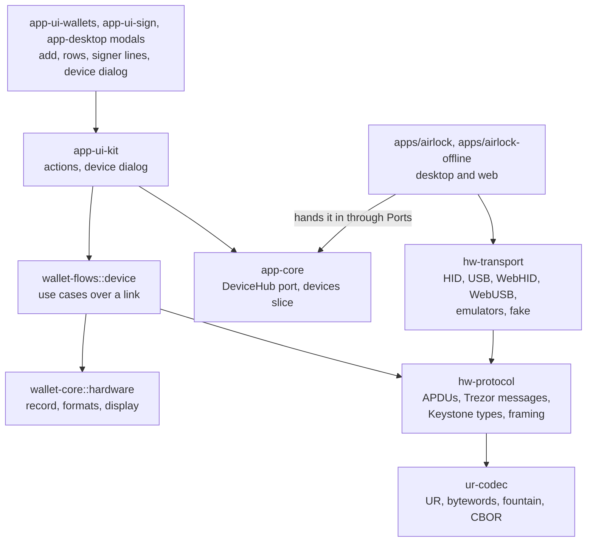

# Plan: hardware wallets (Ledger, Trezor, Keystone)

Status: **proposed**. D1, D3, D4, D6, D7, D9 and D12 were decided on 2026-11-03 ([Decisions](#decisions)). Nothing is built. The wallet record has a placeholder, `WalletKind::Hardware { vendor: Ledger, paths }`, and routing refuses it.

A hardware wallet keeps its key on a device the user holds. Airlock prepares and explains the transaction as it does for any wallet. The device then shows the transaction on its own screen, and signs once the user confirms there. Ledger and Trezor connect over USB. Keystone sends nothing over USB in its default mode, so it uses QR codes, as the airgap device does, though in its own format.

Background: [signing.md](signing.md) for the pipeline as it is, [browser-bridge.md](browser-bridge.md) for site requests and the threat model, [architecture.md](architecture.md) for where code goes.

## What this adds

- Add a Ledger, Trezor or Keystone account as a wallet: read its address from the device, check it on the device's screen, label it, and see its balances like any other wallet's.
- Sign with it wherever a key signs today: Build, Stake, Wallets actions, Proposals, the Sign screen's inbox, and site requests (`signTransaction`, `signAndSendTransaction`, `signAndSendAllTransactions`).
- Use it as another wallet's fee payer, as the acting member of a Squads multisig, and as a programmatic signer's authority ([A programmatic signer's authority](#a-programmatic-signers-authority)).
- Sign messages and sign-ins for sites where the device can (see [Messages and sign-in](#messages-and-sign-in)).
- The same in Airlock Offline, in the same release. A hardware wallet on the offline device signs what Airlock sends it over QRS1, and Airlock adds it as an offline key ([Airlock Offline](#airlock-offline)).
- v1 only, as Airlock is today. A device must read v1: Ledger's Solana app 1.18, Trezor's next release, Keystone 3.0.6. Until Ledger and Trezor release theirs, the work is built and tested on their pre-release builds ([D1](#decisions)).
- Desktop first (Windows, macOS, Linux). The web build follows, with WebHID and WebUSB in Chromium browsers. Keystone works in every build that has a camera.

Left out, and why:

| Left out | Why |
| --- | --- |
| Legacy transactions for devices that read no v1, from Airlock's builder or over QRS1 | An optional TODO for later, if it turns out to be needed. The devices read v1 from the versions above, and Solana means to retire legacy and v0 at some point. See [D3](#decisions) |
| Bluetooth (Ledger Nano X, Stax, Flex, Nano Gen5; Trezor Safe 7) | A TODO for later. USB covers every model. BLE means GATT on three OSes, and THP pairing for the Safe 7 |
| A hardware key as the key of a Vector account | Vector's key signs a 32-byte digest, not a message. Ledger and Trezor sign only transactions and off-chain messages. Keystone would sign the digest as raw hex, which tells the user nothing. See [D9](#decisions) |
| Installing or updating device apps and firmware, and genuineness checks | Ledger Live and Trezor Suite do that. Ledger's genuine check needs Ledger's servers |
| Ledger's trusted names, token descriptors and transaction checks (INS `0x20`–`0x23`), Trezor's signed token definitions | Each needs data signed by the vendor's backend, so a request to the vendor about the user's transaction. See [D7](#decisions) |
| Trezor Connect, Trezor Bridge, Ledger's Device Management Kit | They are JavaScript, and Bridge is a localhost HTTP server. Airlock talks to the devices itself, in Rust |

## The APIs at a glance

| Layer | Ledger | Trezor | Keystone |
| --- | --- | --- | --- |
| Device API | Solana app APDUs, CLA `E0`: `04` config, `05` pubkey, `06` sign, `07` sign off-chain message. Dashboard APDUs `B0 01`, `E0 D8`, `B0 A7` | Protobuf messages 900–907, and the session messages (`Initialize`, `ButtonRequest`, `PassphraseRequest`, `Cancel`) | UR types `sol-sign-request` (1101), `sol-signature` (1102), `crypto-multi-accounts` (1103) |
| Framing | HID reports: channel `0101`, tag `05`, packet index | Codec v1 (`?##`) on older models, THP (Noise XX, pairing) on the Safe 7 | BC-UR (bytewords, fountain codes) in QR codes; 64-byte packets over USB |
| Link | USB HID, vendor `2C97` | USB vendor interface, `1209:53C1` | camera and screen; USB `1209:3001` with Air-Gap mode off |
| Desktop, in Rust | `async-hid` or `hidapi` | `nusb`, `trezor-thp` | the camera and `qr-codec` that exist, and a new `ur-codec` |
| Web | WebHID | WebUSB (`nusb`'s web backend) | the camera |
| Tests | Speculos: APDUs on TCP 9999, buttons on its REST API (5000) | the emulator on UDP 21324, DebugLink to press | test vectors; a real device |
| Solana formats | legacy, v0; v1 in developer builds from app 1.18 | legacy, v0; v1 from the next release | legacy, v0, v1 |
| Messages | off-chain message v1 (OCMS) | off-chain message v1 (OCMS) | the raw bytes |

## Verified on 2026-11-03

Read from each vendor's firmware source and release notes. Versions move, so check again before each package starts.

| | Ledger | Trezor | Keystone |
| --- | --- | --- | --- |
| Read | Solana app 1.16.1 (`LedgerHQ/app-solana`, master), and its tags up to 1.17.0-dev2 | core firmware 2.13.0 (21 Oct 2026) and main | Keystone 3 firmware 3.2.0 (23 Oct 2026) |
| Models | Nano S Plus, Nano X, Stax, Flex, Nano Gen5 (`apex_p`). The first Nano S is no longer built for | Model T, Safe 3, Safe 5, Safe 7. Not Model One | Keystone 3 Pro, Web3 firmware (not BTC-only or Cypherpunk) |
| Link | USB HID; BLE on all but the Nano S Plus | USB; BLE on the Safe 7 | QR; USB once Air-Gap mode is off |
| Legacy and v0 | Yes. A v0 message with lookup tables is blind-signed | Yes. Lookup-table accounts are shown by table and index | Yes |
| v1 (SIMD-0385) | **Not in a release.** 1.16.1 reads a `0x81` message as a malformed v0 one and refuses it with `6A80` ([app-solana#248](https://github.com/LedgerHQ/app-solana/issues/248), open). Developer builds read v1 from app 1.18. Their source is not public yet | Merged on 7 Oct 2026 (`core/.changelog.d/8055.added`), not in 2.13.0: **the next release** | **Yes**, since 3.0.6 (September 2026) |
| Off-chain messages | INS `07`: v0, and v1 from app 1.14 | `SolanaSignMessage`, v1 only since 2.12.4, which removed v0 | Signs the raw bytes it is given, shown as text or hex |
| Shown in words | At most 6 instructions, all of System, Stake, Vote, SPL Token, Token-2022, Associated Token, Memo, Compute Budget or Serum assert-owner, and no lookup tables | System, Stake, Compute Budget, Token, Token-2022, Associated Token, Memo | System, Stake, Vote, Token, Token Lending, Token Swap v3, Squads v4, Jupiter v6 |
| Anything else | Refused unless Blind signing is on in the app's settings. Then "Unrecognized format", **Message Hash** (base58 of the SHA-256 of the message), and the fee payer | A blind-signing warning, then each unknown instruction's program id, accounts and data, a screen each | Program, accounts and data, raw |

v1 has been live on mainnet since epoch 1035 (15 Sep 2026, feature `txv1aq4pp281K9um3tnPgkfX8UqtFT6wcVW3hNezGLL`). Sites can send it, and Airlock compiles everything as v1. Ledger's released app and Trezor's 2.13.0 cannot sign it, so this plan targets their pre-release builds ([Transaction formats](#transaction-formats)).

## Where things stand

- `crates/wallet-core/src/wallets/record.rs` has `HardwareVendor { Ledger }` and `WalletKind::Hardware { vendor, paths }`, with no pubkey. `WalletRecord::address()` is `None` for it (`record_keys.rs`), so `signing_route` refuses it with `RouteError::Hardware` ("Hardware wallets are not supported yet."). `can_sign` and `can_pay` are false. `adapt::plan` and `proposals::combined` skip it, and `shared_keys` gives it nothing. The screens cannot make one, so the shape can change without a migration; only `proposals/tests/combined.rs` builds one.
- `WalletClass::Hardware`, `WalletSort::Hardware` and `Glyph::Device` exist. Wallets shows an empty "Hardware wallets" group that says they are not supported, and Add wallet has a Hardware tab that says import is not available yet (`app-ui-wallets/src/ui/wallets/add_modal.rs`, `mod.rs`).
- Everything this app builds is v1 (`tx::builder::compile_v1`, `compile_v1_budget`), and so is every rebuild (`wallet_flows::adapt`). A site's legacy or v0 transaction is signed as it is only when every unsigned slot is a hot key here (`wallet_flows::request::route_created`). Otherwise it is converted to v1 (`tx::convert::to_v1`).
- QRS1's transaction object (kind 1) takes a v1 wire only (`QrObject::check`), and the Sign screen reads a scanned one with `decode_v1_transaction`. Kind 5, the wallet keys one device shares with another, says nothing about formats.
- A programmatic signer's authority signs `Authorization::signing_bytes()`: a v1 message whose only instruction is the executor's `Execute`, with `Hash::default()` for a blockhash. A signature made elsewhere goes in through `relay::insert_authority_signature_in`, which checks it first. Setting up a programmatic signer is an ordinary transaction: the authority is named in it, but does not sign it (`create_executor_nonce`).
- Airlock Offline is the same shell (`app-ui`, `app-desktop`, `open_core`) without `app-online`: Wallets, Build and Sign, and no node. `check-airgap-deps.sh` keeps network crates out of its tree.
- Signing is synchronous: `WalletSigner::try_sign_message` (`keys/signer.rs`), called by `wallet_flows::sign::sign_with` from `sign_unlocked` (`app-ui-kit/src/actions/sign_screen.rs`).
- A signature brought in from elsewhere goes through `insert_signature` (`tx/signatures.rs`), which checks it against the message first. Inserting one does not return a browser request to its site (signing.md, Known gaps).
- `site_message::check_message` refuses bytes in the off-chain format ("which Airlock does not sign yet"). A message is signed over exactly the bytes the site sent.
- `qr-codec` encodes one byte-mode segment and decodes numeric, alphanumeric and byte segments. QRS1 always draws version 23.
- Sites get accounts with a `signsMessages` flag each (`bridge_protocol::reply`), so a site sees `solana:signMessage` only on accounts that can do it.
- `SolanaRpc` already has `get_lamports` and `get_signatures_for_address`, which is all account discovery needs.

## The APIs we target

### Ledger: the Solana app over USB HID

**Finding the device.** USB vendor `0x2C97`. Outside the bootloader, the product id's high byte is the model: `0x40` Nano X, `0x50` Nano S Plus, `0x60` Stax, `0x70` Flex, `0x80` Nano Gen5. Bootloader ids are `0x0004` to `0x0008`. A device has several HID interfaces. APDUs go to interface 0 (vendor usage page `0xFF00`), not to the FIDO one.

**Framing.** 64-byte HID reports, written with a leading report id `0x00` through hidapi. Each report starts with the channel, `0x0101` (u16, big-endian), the tag `0x05`, and the packet index (u16 BE, from 0). The first report then carries the APDU's length (u16 BE). The reply comes back the same way and ends with a two-byte status word. BLE uses the same framing without the channel.

**Dashboard commands**, answered whatever app is open:

| APDU | What it does |
| --- | --- |
| `B0 01 00 00` | Name and version of the open app (`BOLOS` on the dashboard) |
| `E0 D8 00 00 <len> "Solana"` | Opens the Solana app; the device asks the user. `6807` unknown app, `5501` refused |
| `B0 A7 00 00` | Quits the open app |

**Solana app commands**, CLA `E0`. A BIP-32 path is a count byte, then each index as u32 BE, hardened ones with `0x8000_0000` set. The app derives only under `44'/501'`, and takes 1 to 5 indices.

| INS | Name | P1 / P2 | Data | Reply |
| --- | --- | --- | --- | --- |
| `04` | Get app configuration | `00` / `00` | none | blind signing on, pubkey display mode, version (major, minor, patch), then two transaction-check flags on recent versions |
| `05` | Get pubkey | `00` silent, `01` shown on the device to confirm / `00` | path | 32-byte key |
| `06` | Sign transaction | `01` (the app refuses `00`) / chunk flags | first chunk: `01` (signers, always 1), the path, then the message; later chunks: the rest of the message | 64-byte signature |
| `07` | Sign off-chain message | as `06` | as `06`, with the off-chain message | 64-byte signature |
| `08`, `09`, `16`, `20`–`23` | Preview, delayed signing, descriptors, trusted names, transaction checks | | | not used ([D7](#decisions)) |

A chunk carries at most 255 bytes. P2 bit `0x01` (EXTEND) says the chunk continues a message, and bit `0x02` (MORE) that another chunk follows: `02` on the first of several, `03` in the middle, `01` on the last, `00` when one chunk holds everything. The app keeps up to 15,312 bytes. The message is what the signatures cover: the wire without its signatures. The key at the path must be one of the message's required signers, or the app answers `6A81`. A 1.18 developer build should take a v1 message through the same `06`, a 4,096-byte one in 17 chunks. Check it on that build before relying on it.

**Status words.** `9000` done. `6985` the user rejected it. `6808` not supported: blind signing is off, or the message is something the app will not do. `6A80` not a message the app reads, which is what a v1 message gets before 1.18. `6A81` bad header, or the key is not a signer. `6A82` bad off-chain format. `6A83` too long. `6A84` bad path. `6D00` and `6E00`: the open app is not Solana. `5515` the device is locked. `5502` no PIN is set.

**What the device shows.** Up to six instructions of the programs it knows, with no lookup tables, are shown in words. Anything else needs Blind signing turned on in the app's settings. The device then shows "Unrecognized format", **Message Hash**, and in some cases the fee payer. The host cannot take a request off the device's screen: the user rejects it there.

**References.** `doc/api.md`, `src/apdu.c` and `src/globals.h` in app-solana. Agave's `solana-remote-wallet` (`remote-wallet/src/ledger.rs`) is a Rust implementation of the same protocol, the one the `solana` CLI uses for `usb://ledger`.

### Trezor: protobuf messages over USB

**Finding the device.** USB `1209:53C1` (`1209:53C0` in the bootloader). Interface 0 is vendor class (WebUSB), with interrupt endpoints `0x01` out and `0x81` in, and 64-byte packets. Windows binds WinUSB to it from the device's own descriptors, so nothing is installed. Linux needs udev rules (`51-trezor.rules`). Only one process can claim the interface: while Trezor Suite holds it, Airlock gets "busy".

**Two protocols.** Models before 2025 speak Codec v1. The Safe 7 speaks the Trezor–Host Protocol (THP). Probe as trezorlib does (`get_client` in `trezorlib/client.py`): Codec v1 first, then THP.

- **Codec v1.** The first packet is `?##`, the message type (u16 BE), the length (u32 BE), then the first 55 bytes of protobuf. Each next packet is `?` and 63 more bytes. Zero-padded.
- **THP** (`docs/common/thp/specification.md`). A transport layer (channel allocation, segmenting, CRC32, alternating-bit acknowledgements), a Noise XX handshake (`Noise_XX_25519_AESGCM_SHA256`, with Trezor's static key masked), then pairing the first time a host connects. The spec says only Code Entry pairing works for now: the Trezor shows a code, the user types it on the host, with CPace underneath. Once paired, the host can ask for a credential that skips pairing the next time. Application messages are the same protobuf, encrypted. [`trezor-thp`](https://crates.io/crates/trezor-thp) 0.1.1 implements both sides, `no_std` and with no I/O. Its example pairs only with SkipPairing, which the emulator allows, so Code Entry's CPace step has to be checked there or written.

**Session messages**, with their ids in `messages.proto`:

| Id | Message | Use |
| --- | --- | --- |
| 0 → 17 | `Initialize` → `Features` | Model (`internal_model`), firmware version, `device_id`, unlocked, passphrase protection |
| 55 | `GetFeatures` | The same, without resetting the session |
| 26 / 27 | `ButtonRequest` / `ButtonAck` | The device waits for the user. Ack each one, and show "Confirm on your Trezor" |
| 41 / 42 | `PassphraseRequest` / `PassphraseAck` | Always answered `on_device: true`: the passphrase is typed on the Trezor, never in Airlock |
| 18 / 19 | `PinMatrixRequest` / `PinMatrixAck` | Model One only, which has no Solana. An error here |
| 20 | `Cancel` | Ends what the device is showing |
| 3 | `Failure` | `code` and `message`. `ActionCancelled` is a rejection |
| 83 | `EndSession` | When the dialog closes |
| 1000 | `ThpCreateNewSession` | A THP session, with the passphrase choice |

**Solana messages** (`messages-solana.proto`):

| Id | Message | Fields |
| --- | --- | --- |
| 900 → 901 | `SolanaGetPublicKey` → `SolanaPublicKey` | `address_n` (the path), `show_display` → `public_key` |
| 902 → 903 | `SolanaGetAddress` → `SolanaAddress` | `address_n`, `show_display`, `chunkify` → `address` (base58), `mac` |
| 904 → 905 | `SolanaSignTx` → `SolanaTxSignature` | `address_n`, `serialized_tx` (the message bytes), `additional_info { token_accounts_infos: [{ base_address, token_program, token_mint, token_account }], encoded_token }`, `payment_req`, `chunkify` → `signature` |
| 906 → 907 | `SolanaSignMessage` → `SolanaMessageSignature` | `address_n`, `message: SolanaOffchainMessageV1 { message (text), signers }`, `chunkify` → `signature`, `signed_data` (the bytes it signed) |
| 908 | `SolanaVerifyMessage` | not used |

`token_accounts_infos` lets the device say whose account a token transfer goes to. Airlock fills it from the chain (owner, program, mint and token account), which needs nothing from Trezor. `encoded_token` is a token definition signed by Trezor, and `payment_req` a SLIP-24 payment request. Neither is used.

**What the device shows.** Known programs in words. An unknown program gets a blind-signing warning, then its program id, accounts and data, a screen per instruction. A pending change lets the Safe 5 and Safe 7 skip that review, so a long transaction does not time out the host (`7918.added`). A transaction with more than one required signer gets a "requires N signers" screen first.

**Licences.** `common/protob` is LGPL-3.0, so its `.proto` files are not copied. The thirty-odd messages are written by hand as `prost` structs ([D5](#decisions)). `trezor-client` (CC0) has Solana bindings, but it needs `rusb`, which builds libusb.

### Keystone: UR over QR

Keystone 3 Pro has a camera and a screen, and in its default Air-Gap mode no USB data. It speaks [BC-UR](https://github.com/BlockchainCommons/Research/blob/master/papers/bcr-2020-005-ur.md): CBOR written as bytewords in `UR:<TYPE>/...` text, cut into fountain-coded parts when it does not fit one QR code (`UR:<TYPE>/<seq>-<total>/...`). Upper case, so the QR code can use alphanumeric mode.

**Account export.** On the Keystone: Connect Software Wallet, then a Solana wallet from its list (Solflare, Backpack, Jupiter, Nightly, Helium, NuFi; there is no Airlock entry). It shows `ur:crypto-multi-accounts` with up to 10 keys of the path type the user picks there: Account-based `m/44'/501'/X'`, Single Account `m/44'/501'`, or Sub-account `m/44'/501'/X'/0'`.

```text
crypto-multi-accounts = #6.1103({
  1: uint32,                     ; master fingerprint
  2: [+ #6.303(crypto-hdkey)],   ; each: 3 key data (the Ed25519 key), 6 origin #6.304(crypto-keypath), 9 name, 10 note
  ? 3: text,                     ; device ("Keystone 3 Pro")
  ? 4: text,                     ; device id, from the serial number
  ? 5: text,                     ; firmware version
})
crypto-keypath = #6.304({
  1: [* (uint32, bool)],         ; components: index, hardened
  ? 2: uint32,                   ; source fingerprint
  ? 3: uint8,                    ; depth
})
```

A `qr-hardware-call` (1201) carrying a `key-derivation-call` (1301) of `key-derivation-schema`s (1302: path, curve 1 for Ed25519, algorithm 0 for SLIP-10, chain `"SOL"`) asks for keys at paths the host chooses. Keystone's USB SDK sends it. Whether a scanned one is accepted for Solana has to be checked on a device ([D11](#decisions)).

**Signing.**

```text
sol-sign-request = #6.1101({
  ? 1: #6.37(bytes .size 16),   ; request id, a UUID
  2: bytes,                     ; what to sign: the message bytes, or the raw message
  3: #6.304(crypto-keypath),    ; the path, with the master fingerprint as source fingerprint
  ? 4: bytes,                   ; the address
  ? 5: text,                    ; origin, shown on the device: "Airlock"
  6: uint,                      ; 1 transaction, 2 message
})
sol-signature = #6.1102({ ? 1: #6.37(bytes), 2: bytes .size 64 })
```

The firmware reads the payload itself (`classify_payload` in `rust/apps/solana/src/lib.rs`). Bytes that parse as a message are a transaction. Bytes that start like one and do not parse, or start with `0x81`, are refused. Anything else is signed as a message, as it is.

**USB**, optional and later. `1209:3001`, once Air-Gap mode is off in the device's settings. 64-byte packets: CLA `00`, the command (u16 BE), the packet count (u16), the packet index (u16), a request id (u16), then up to 55 bytes. Commands: echo `1`, resolve UR `2`, lock status `3`, export address `4`, device version `5`, USB public key `6`. Resolve UR carries the same UR text as the QR codes (`KeystoneHQ/keystone-sdk-usb`, `hw-app-sol` and `hw-transport-usb`).

**Libraries.** Keystone's `ur-registry` 1.0.9 (MIT) has these types. It also brings `minicbor` 0.19, `prost` 0.11 (Trezor's messages use 0.14), `libflate` pinned at 2.2.2, and every chain's types. The `ur` crate 0.5.2 (MIT) has UR, bytewords and fountain codes, and needs `minicbor` 2. `minicbor` is BlueOak-1.0.0, which is not on `deny.toml`'s list. The UR layer is small, so it becomes an `ur-codec` crate of our own, as `qr-codec` is ([D6](#decisions)).

### Off-chain messages (OCMS v1)

What Ledger and Trezor sign for a message ([Anza's spec](https://docs.anza.xyz/proposals/off-chain-message-signing), sRFC 38):

| Offset | Bytes | Field |
| --- | --- | --- |
| 0 | 16 | `ff`, then `solana offchain` |
| 16 | 1 | version, `1` |
| 17 | 1 | signer count, not 0 |
| 18 | 32 × n | the signers, in ascending byte order, no repeats |
| after them | the rest | the text: UTF-8, not empty, no length prefix |

The signature covers all of it. A transaction message can never start with `0xff`.

### Host APIs and crates

| What | For | Version, licence |
| --- | --- | --- |
| [`async-hid`](https://crates.io/crates/async-hid) | Ledger on desktop: pure Rust over each OS's HID API | 0.5.3, MIT |
| [`hidapi`](https://crates.io/crates/hidapi) | the alternative (C, built with `cc`); what Agave uses | 2.6.7, MIT |
| [`nusb`](https://crates.io/crates/nusb) | Trezor and Keystone USB: pure Rust on Windows, macOS and Linux, and WebUSB in the browser | 0.2.9, MIT or Apache-2.0 |
| [`trezor-thp`](https://crates.io/crates/trezor-thp), `trezor-noise-protocol`, `trezor-noise-rust-crypto` | THP for the Safe 7 | 0.1.1 MIT or Apache-2.0; 0.2.1 and 0.6.2 Unlicense |
| [`prost`](https://crates.io/crates/prost) | Trezor's messages, as hand-written structs | 0.14, Apache-2.0 |
| [`btleplug`](https://crates.io/crates/btleplug) | Bluetooth, later | 0.13, MIT, Apache-2.0 or BSD-3-Clause |
| WebHID (`navigator.hid`), WebUSB (`navigator.usb`) | the web build; Chromium only, secure context, a click before `requestDevice` | `web-sys` behind `--cfg=web_sys_unstable_apis` |

Each of these licences is on `deny.toml`'s list. `cargo deny check` covers what they bring in.

## Design

### A key on a device

A hardware wallet is a key, like a hot or offline wallet. What differs is where its signature comes from:

| | Hot | Hardware | Offline |
| --- | --- | --- | --- |
| Key | this vault | a device connected here, or a Keystone held up to the camera | another device |
| Signature | at once, on Sign | over USB or QR, once the user confirms on the device | a QRS1 round trip |
| Pays fees | yes | yes | yes |
| Acting member of a multisig | yes | yes | yes |
| Authority of a programmatic signer | yes | yes | yes |
| Key of a Vector account | yes | no ([D9](#decisions)) | yes |
| Formats it signs | any | v1 | v1 (QRS1) |
| Who decides | this app | the device | the other device |

The device decides for its key, as the offline device does for its own. What Airlock shows is advisory. What the device shows is what the user confirms.

### The record

Replace the placeholder:

```rust
Hardware {
    vendor: HardwareVendor, // Ledger | Trezor | Keystone
    /// The key at `path`, read from the device when the wallet was added.
    pubkey: Pubkey,
    /// Concrete path, such as `m/44'/501'/0'/0'`.
    path: String,
    /// What names the device beyond the key: Trezor's device id, or
    /// Keystone's master fingerprint. Ledger has none.
    #[serde(default, skip_serializing_if = "Option::is_none")]
    device: Option<String>,
    /// Model and firmware (Ledger: Solana app) version last seen, checked
    /// against the minimum on every connect.
    #[serde(default)]
    seen: DeviceSeen,
    #[serde(default, skip_serializing_if = "Option::is_none")]
    fee_payer: Option<WalletId>,
    /// As for an offline wallet: for a Keystone round trip, or several
    /// devices one after another.
    #[serde(default, skip_serializing_if = "Option::is_none")]
    durable_nonce: Option<Pubkey>,
    /// As for an offline wallet: which path acts when this key is chosen,
    /// the key itself, its programmatic signer or its durable nonce.
    #[serde(default, skip_serializing_if = "Option::is_none")]
    default_path: Option<OfflinePath>,
}
```

- Nothing in it is secret. `without_secrets` copies it whole, so it shows, routes and syncs while the vault is locked.
- `address()` is `pubkey`. `can_sign()` stays false, since the vault holds no key. A new `signs_on_device()` is true, and `can_pay()` is true.
- `WalletClass::Hardware` groups it on Wallets, as today.
- The same key can be both a hardware wallet and an offline or hot wallet, when its seed is somewhere else too. `shared_keys` treats it as it treats an offline key.
- THP pairing credentials live in the vault, outside the record. They let this host reconnect to a Safe 7 without pairing again.
- Airlock Offline's vault holds the same records.

### Routing and fee payers

- `signing_route` gets `RouteStep::DeviceKey { wallet, pubkey, vendor }`, which ends a chain as `Key` does. A hardware wallet's route is `[DeviceKey]`. A multisig whose acting member is a hardware wallet is `[Squads, DeviceKey]`.
- A programmatic signer whose authority is a hardware wallet routes `[Programmatic, DeviceKey]`. A hardware row offers **Set up** for a programmatic signer, as an offline row does.
- A Vector wallet's key cannot be a hardware wallet ([D9](#decisions)).
- `is_local()` is true for `DeviceKey`, and the fee payer falls to it when none is set, as for a hot key. `can_pay` lets a hardware wallet pay for another wallet.
- `adapt::plan` stops skipping hardware members, and `proposals::combined` takes them.

### Transaction formats

Airlock compiles v1, and with hardware wallets it still does: the device must read v1 ([D1](#decisions)). Nothing in the builder changes.

| Source | With a hardware signer |
| --- | --- |
| Build, Stake, Wallets actions, Proposals, Squads rebuilds | v1, as today |
| A site's v1 request | routed as v1, as today |
| A site's legacy or v0 request | converted to v1 (`to_v1`), as it is today when an offline key signs, with the same notice in the modal |
| QRS1 | v1, as today |

- **Minimum versions.** A device below its minimum is refused when it connects, with the version to update to ([D12](#decisions)). `seen` keeps the version it last had, so Sign can say so before the dialog opens.
- **Pre-release builds.** Until Ledger's 1.18 and Trezor's next release are out, only their pre-release builds can sign. Until then those two vendors are offered only behind a Settings switch ([D13](#decisions)).
- **Legacy** is an optional TODO, for later ([D3](#decisions)). [H8](#h8-later-todo) says what it would take.

### Signing

**Signer state.** `SignerState` gets `Device`: not signed, and a hardware wallet of this vault holds the key. `LocalKeys` gets `devices: &[(Pubkey, HardwareVendor)]`, and `SigningStatus::on_devices()` counts them. A device line is not `Local`, since no vault key signs it, and not `Missing`, since no one else has to bring it.

**Steps.** `sign_steps` gets `SignOnDevice { vendor }`, shown as "Sign on Ledger" (or Trezor, or Keystone), after Sign transaction and before Collect signatures. `only_simulate_and_sign` treats it as Sign transaction, so a Ledger wallet's plain transfer still hides the row.

**The press.** Sign does what it does today for hot keys, then opens the device dialog for each open device line in turn, fee payer first. When only device lines are open it does not ask for the vault password, as inserting an offline signature does not: no secret is read ([D10](#decisions)). A Safe 7 whose pairing credential is in a locked vault is the exception.

**Before the device.** The blockhash rule stays (`BlockhashOnSign`): what this app made or relays, and nothing has signed yet, moves to a fresh blockhash first, so the device's confirmation gets the whole window. The dialog shows the clock the modal already keeps.

**The device dialog**, new in `app-ui-kit` (`ui/device`). One flow for the three, each step shown as it passes:

| Step | Ledger | Trezor | Keystone |
| --- | --- | --- | --- |
| Find | "Connect and unlock your Ledger", until one answers | "Connect your Trezor" | — |
| App | "Open the Solana app", with **Open it** (sends `E0 D8`) | — | — |
| Account | Get pubkey at the path equals the record's key. Otherwise stop: "This Ledger does not hold ‹address›. Is it another device, or another passphrase?" | `SolanaGetPublicKey`, the same check, and `device_id` | — |
| Version | Solana app below 1.18: refused, with the version to update to | firmware below the minimum: the same | checked when the wallet is added, from the export's firmware version when it has one |
| Blind | predicted blind and the app's Blind signing is off: "Turn on Blind signing in the Solana app's settings, then Retry" | warns that each unknown instruction is shown raw | — |
| Confirm | "Confirm on your Ledger", with what it will show (below) | "Confirm on your Trezor", acking each `ButtonRequest` | shows the `sol-sign-request` codes, then **Scan the signature** |
| Done | verify the signature over the message with the record's key, `insert_signature`, then the next line | the same | the same, and the request id must match |

Rejected on the device, unplugged, locked, busy (another app holds it) and timed out each get their own sentence. Cancel sends `Cancel` to a Trezor. For a Ledger it says to reject on the device.

**What the device will show** (`hardware::expected_display(vendor, &tx)`), said in the dialog before it is sent:

- Ledger, in words: what Airlock's own review says for those programs, "Your Ledger shows the transfer of 1.5 SOL to ‹address›".
- Ledger, blind: "Your Ledger shows **Message Hash** 7xKX…Qe and fee payer ‹address›. Check that they match before you confirm." Airlock computes the hash, base58 of the SHA-256 of the message. A match shows that the device signs what this screen shows. It says nothing about a compromised Airlock, which would show its own hash. See [Security](#security).
- Trezor: which instructions it will show raw.
- Keystone: nothing predicted. It reads more programs than the others.

**Logging.** The `signed` stage logs `by=ledger`, `trezor` or `keystone` under `airlock::tx`, with the flow id. Device events go to a new target, `airlock::device` ([Logging](#logging)).

### A programmatic signer's authority

The signer program was shaped for this ([D9](#decisions)). An authority signs `Authorization::signing_bytes()`, a Solana message, so a device signs it as a transaction: INS `06`, `SolanaSignTx`, or a `sol-sign-request` of type 1.

- **It is v1**, which every device at its minimum version reads ([D12](#decisions)).
- **It is blind on every device.** What runs is inside `Execute`'s data. A Ledger needs Blind signing on, and shows **Message Hash**, which the dialog shows too. A Trezor and a Keystone show the executor call raw. A device that names a fee payer names the first signer. Nothing is charged to it, and the dialog says so.
- **No clock.** The message has no blockhash, so a slow confirmation or a Keystone round trip costs nothing. The relay transaction around it has one, and is signed afterwards.
- **The order.** The authority signs first, on the device. Its signature goes in through `insert_authority_signature_in`, as a scanned one does. Then the relay transaction's signers sign it. A Ledger that is both the authority and the fee payer confirms twice: the authorization, then the relay.
- **Setting one up** needs nothing from the device. The executor nonce's creation names the authority, and the authority does not sign it.
- A Keystone authority with the programmatic signer as its default path needs neither a durable nonce nor a fresh blockhash for its own signature. That suits a QR round trip.

### Browser requests

- **Connect** lists hardware wallets among the keys this device can act as. `signsMessages` follows [Messages and sign-in](#messages-and-sign-in).
- **The modal's Sign** reads **Sign on Ledger** when a device line is open, and runs the device dialog inside the modal. `quick_sign` counts device keys as ones this device can add. Sign stays amber for the same reasons as today.
- **Formats** follow [Transaction formats](#transaction-formats): a legacy or v0 request with a hardware signer is converted to v1, with the conversion notice the modal shows today.
- **Batches** sign one transaction at a time on the device, in order: 16 transactions are 16 confirmations against the site's one blockhash. The modal says so before the first.
- **A signature that completes a request** returns it to the site, however it arrived. Today only a local Sign returns one (signing.md, Known gaps). A Keystone signature arrives by scan, so the Keystone package closes that gap, for offline keys too.
- A Keystone wallet with a durable nonce gets a site's request moved onto it, as an offline key's is (`onto_nonce`).

### Messages and sign-in

| | Ledger, Trezor | Keystone |
| --- | --- | --- |
| What the device signs | an OCMS v1 message: the off-chain header naming the account, then the site's bytes as text | the site's bytes, as they are |
| Text only | yes. Ledger shows ASCII, and other UTF-8 as a hash | no. Hex with the warning, as for a hot key |
| `signMessage` | `signedMessage` is the whole OCMS message. The Wallet Standard allows it: "The wallet may prefix or otherwise modify the message before signing it." | the same as a hot key |
| `signIn` | refused. `@solana/wallet-standard-util`'s `verifySignIn` parses `signedMessage` as the sign-in text, and the header breaks that | the same as a hot key |

- `check_message` runs first, whoever signs. A message that reads as a transaction, a bare 32-byte digest, or a sign-in for another site is refused before a device is asked.
- A site that sends bytes already in the off-chain format is refused today. For a Ledger or Trezor account they can be signed as they are, when they are v1, name exactly this account, and their text passes the same checks ([D4](#decisions)).
- Every hardware account gets `signsMessages`. A Ledger or Trezor `signMessage` returns the OCMS message, and its `signIn` is refused with a sentence ([D4](#decisions)).

### Adding a hardware wallet

Add wallet → Hardware → Ledger, Trezor or Keystone.

**Ledger and Trezor.**

1. The dialog's Find and App steps, and on a Trezor with passphrase protection, the passphrase on the device. A Solana app or firmware below its minimum is refused here, with the version to update to.
2. A path scheme. Presets: `m/44'/501'/*'/0'` (Phantom, Solflare, Trezor Suite, and Airlock's own seed phrases), `m/44'/501'/*'` (Ledger Live), `m/44'/501'` (one account). A custom path is allowed under `44'/501'`.
3. Read the first ten keys of the scheme (Get pubkey with P1 `00`, `SolanaGetPublicKey`), and ten more on request. Online, show each key's balance and whether it has any history (`get_lamports`, `get_signatures_for_address` with a limit of 1), and tick the first one that has, or index 0. With no node, as in Airlock Offline, list the keys alone and tick index 0.
4. **Check on the device** for each ticked key (Get pubkey with P1 `01`, `SolanaGetAddress` with `show_display`). Recommended, not required.
5. Label, then save (a checked save). The model and version go into `seen`, and a Trezor's `device_id` into `device`.

**Keystone.**

1. The modal says: on your Keystone, open Connect Software Wallet, choose Solflare, and pick the path type there.
2. Scan its `crypto-multi-accounts` codes (animated, several frames).
3. List the keys with their paths and balances. Tick, label, save. The master fingerprint goes into `device`, the firmware version into `seen`.

A key already in the vault is listed and cannot be ticked, as on From another device.

### Showing an address on the device

A hardware wallet's row, and the top bar's copy-address card, get **Show on device** for Ledger and Trezor: the device displays the address for the user to compare. On a Keystone row it says to open the account's Receive screen on the Keystone. Malware that swaps a copied address cannot change what the device shows.

### Airlock Offline

Airlock Offline is the same shell, so it has the same hardware wallets in the same release: Add wallet → Hardware, the rows, the device dialog, Sign on the device, Show on device. The crates, flows and screens are shared, and are built once. What differs is only what having no node means:

- **Adding** lists the keys without balances or history, and ticks index 0.
- **Trezor's `token_accounts_infos`** come from the context note's account bytes, when the note has them. Otherwise they are left out, and the Trezor shows token accounts by address.
- **No blockhash move**, as today offline. A transaction signed there rides on its durable nonce or its programmatic signer, or on the blockhash it was scanned with.
- **Sharing a hardware wallet with Airlock** works as for any key, with the wallet keys object (kind 5). Airlock adds it as an offline wallet. From then on it is an offline key: QRS1 both ways, and the user confirms on the device in between.
- **Keystone** works there through the camera and screen, as in Airlock, though Airlock can scan a Keystone itself.

Both shells hand in the device hub the same way ([Where the code goes](#where-the-code-goes)). `hw-transport` is not network code, so the airgap check passes ([Platforms](#platforms)).

### Where the code goes



| Crate | Holds | Does I/O |
| --- | --- | --- |
| `ur-codec` (new) | BC-UR: bytewords, CRC32, the Xoshiro256** fountain encoder and decoder, and a CBOR subset (uint, bytes, text, array, map, tag). No dependencies, as `qr-codec` has none | no |
| `hw-protocol` (new) | `ledger`: APDUs, HID framing, status words. `trezor`: Codec v1 framing, the messages (hand-written `prost` structs), THP through `trezor-thp`, the session's state machine (button and passphrase requests). `keystone`: `sol-sign-request`, `sol-signature`, `crypto-multi-accounts`, `qr-hardware-call`, the USB framing. The `Link` traits a transport implements: `exchange(apdu)` for Ledger, 64-byte `write` and `read` for Trezor and Keystone. It knows bytes, not Solana | no |
| `hw-transport` (new) | The only crate that opens a device. Native: Ledger through `async-hid` ([D8](#decisions)), Trezor and Keystone through `nusb`. Web: WebHID through `web-sys`, WebUSB through `nusb`. Listing and hot-plug. A Speculos link (TCP 9999) and a Trezor emulator link (UDP 21324) behind `emulators`, and a scripted fake behind `fake` | USB, HID |
| `wallet-core` | `wallets/hardware.rs`: `HardwareVendor`, `DeviceSeen`, the minimum versions, `expected_display`, the path presets. The record, `RouteStep::DeviceKey`, `SignerState::Device` and the step. The OCMS v1 writer beside `site_message` | no |
| `wallet-flows` | `device.rs`: open the Solana app, check the key at a path, sign a message or an off-chain message, read keys for discovery, each over a `Link` and tested with the fake. `discover.rs`: balances and history for discovery, over `SolanaRpc` | through the link |
| `app-core` | The `DeviceHub` port (list, watch, open), optional in `Ports`. A `devices` slice of what is connected (vendor, model, locked, open app). One exchange at a time per device. THP credentials in the vault | no |
| `app-ui-kit`, `app-ui-wallets`, `app-ui-sign`, `app-desktop` | the dialog, the add flow, rows, signer lines, the request modal | no |

- `hardware` goes in `layers.rs` beside `squads`, `programmatic` and `offline_nonce`, below `record`, which uses it.
- A new rule for architecture.md's list: `app-core` and the UI crates never depend on `hw-transport`. Each shell hands its `DeviceHub` in through `Ports`, as it picks its other services: `open_core_with` takes the hub, and both shells pass `hw_transport::hub()`.
- Device work runs on the core's `Spawner`, so a signature on its way survives leaving the screen. The dialog reads its progress from a watch, as screens read slices.
- Futures are `MaybeSend`, so the web build's WebHID callbacks can hold `Rc`s.

### Platforms

| | Ledger | Trezor | Keystone |
| --- | --- | --- | --- |
| Windows | HID, no driver | WinUSB, from the device's descriptors | camera; USB later |
| macOS | IOKit HID | IOKit USB | camera |
| Linux | hidraw, with a udev rule for `2c97` | udev rules for `1209:53c0` and `53c1` | camera; a udev rule for `1209:3001` later |
| Web, Chromium | WebHID | WebUSB | camera |
| Web, Firefox and Safari | no | no | camera |
| Airlock Offline | as on its OS | as on its OS | camera |

- The Linux rules ship in `resources/`, and the README says how to install them. A device that is seen but cannot be opened gets a sentence that points there.
- WebHID and WebUSB need a secure context and a click before `requestDevice`, as the camera does. `web-sys` exposes them only under `--cfg=web_sys_unstable_apis`, which the web build and CI's wasm Clippy then pass.
- macOS bundles: check that a notarized build with the hardened runtime opens HID and USB without an entitlement. A task in H2 and H4.
- `check-airgap-deps.sh`: `hw-transport` is not network code, so the tree check passes. The script also fails when `hw-transport`'s `emulators` or `fake` feature is on in `airlock-offline`'s tree, since the emulator links are TCP and UDP.

### Logging

A new target, `airlock::device`, added to architecture.md's table:

- `info`: a device connected or gone (vendor, model, firmware), an app opened, a signature made (vendor, path, pubkey, flow id), a refusal and its status word.
- `debug`: each exchange by name (`GET_PUBKEY`, `SolanaSignTx`), with its length and status word.
- Never: THP static keys, handshake keys, pairing codes or credentials. There is no PIN or passphrase to log, because Airlock never handles one.

### Security

- **The device decides** for its key, and Airlock's reading is advisory, as for an offline key. Signing.md's Who decides and the bridge's trust levels get a row for it.
- **Blind signing is as safe as the host.** A Ledger showing a hash, or a Trezor showing raw data, proves that the device signs what Airlock prepared, not that what Airlock prepared is what the user wants. Airlock says, before sending, when the device will sign blind. It never asks the user to leave Blind signing on.
- **The wrong key.** The key at the path is checked against the record before anything is sent, and the signature against the key and the message before it is written in. Another passphrase or another seed gives another key, so both are caught here.
- **Secrets stay on the device.** PINs are typed on the devices. Trezor's passphrase is answered `on_device`. Model One, which would need the PIN typed on the host, is not supported.
- **A swapped address.** Show on device, when adding and on the row.
- **Another app on the link.** When Ledger Live or Trezor Suite holds the device, Airlock says to close it, and never retries into its exchange.
- **THP pairing** keeps a man in the middle off the Safe 7's link. Its credentials are sealed in the vault.
- **Keystone codes.** The request id must match and the signature must verify, and a code of another request is ignored. The UR's CRC32 catches a misread, not a forgery, as QRS1's does.
- **Authorizations are signed blind** on every device ([A programmatic signer's authority](#a-programmatic-signers-authority)). What the user checks is Airlock's review, and on a Ledger the hash.
- **Pre-release builds** are for testing, and the Settings switch says so ([D13](#decisions)).
- **No vendor servers.** Nothing in this plan sends a request to Ledger, Trezor or Keystone ([D7](#decisions)).
- **The fake device** for tests and screenshots sits behind a feature that release builds cannot turn on.

### Testing

| Level | What | Where |
| --- | --- | --- |
| Codecs | APDUs and chunks against app-solana's `doc/api.md` and its tests; HID framing round trips; Codec v1 packets; protobuf against trezorlib's encodings; UR against the BCR-2020-005 vectors and the UR strings in Keystone's `ur-registry` tests; OCMS v1 against Anza's spec | `hw-protocol`, `ur-codec` |
| Use cases | open app, wrong app, locked, wrong key, rejected, blind signing off, an app or firmware below the minimum, Trezor's button and passphrase loops, a Keystone round trip, an authorization signed on the device | `wallet-flows`, with the fake link |
| Signing | `SignerState::Device`, steps, routes, a hardware authority, combined approvals, a site's legacy or v0 request converted for a hardware signer | `wallet-core` |
| Two devices | a hardware wallet in Airlock Offline's vault, shared with Airlock and signing its requests over QRS1 | `flow-tests`, with the fake link |
| Real apps | Speculos with a 1.18 developer build of the Solana app (Docker `ghcr.io/ledgerhq/speculos`; APDUs on TCP 9999, buttons through its REST API on 5000), and the Trezor emulator built from `main` (UDP 21324, DebugLink to press). The transactions they sign run in LiteSVM | a new `crates/hw-tests`, run in CI like `flow-tests` |
| Screens | `scripts/drive-desktop.mjs` with the fake device: the dialog's steps, Sign on Ledger in the modal, the Keystone codes | screenshots for each PR |
| Devices | a checklist per package, on real devices: each model claimed, on each OS, in both shells | the PR description |

Speculos needs the app binary. The public source stops before 1.18, so CI takes the developer build's binary and checks its pinned hash, as `scripts/fetch-programs.mjs` does for programs. Where CI fetches it from is open until Ledger publishes one. Once 1.18 is public, build it from a pinned commit with Ledger's `ledger-app-builder` image. The Trezor emulator is built from a pinned commit of `main`, which reads v1, and moves to the release tag once there is one.

## Work packages

### H0. Record and route (`wallet-core`, `wallet-flows`, no screens)

- Reshape `WalletKind::Hardware` and `HardwareVendor`. `address`, `without_secrets`, `can_pay`, `signs_on_device`, `class`, `shared_keys`.
- `wallets/hardware.rs`, with the minimum versions, and its place in `layers.rs`.
- `RouteStep::DeviceKey` and `[Programmatic, DeviceKey]`. `adapt::plan` and `proposals::combined` take hardware members.
- `SignerState::Device`, `LocalKeys::devices`, `SignStepKind::SignOnDevice`. `quick_sign` counts device keys.
- `request::route_created` converts a site's legacy or v0 request to v1 when a hardware key signs it, as it does for an offline key.
- Tests for each, and a `flow-tests` Squads proposal with a hardware member.

### H1. `ur-codec` and `hw-protocol` (no I/O)

- `ur-codec`, whole ([D6](#decisions)). Only H3 needs it, but it depends on nothing, so it goes early.
- `hw-protocol::ledger`, whole. `trezor`: Codec v1 and the messages. `keystone`: the types.
- The `Link` traits and the fake.

### H2. Ledger

- `hw-transport`'s native Ledger link, listing and hot-plug.
- `app-core`'s `DeviceHub` port and `devices` slice. `open_core_with` takes the hub, and both shells pass `hw_transport::hub()`.
- `check-airgap-deps.sh` fails on `hw-transport`'s `emulators` or `fake` feature.
- `wallet-flows::device` for Ledger, built and tested on the 1.18 developer build, including a v1 message through `06`.
- The device dialog. Add wallet → Hardware → Ledger, with balances when there is a node. The row, with Show on device. Sign on the Sign screen and in the request modal. Messages: `signMessage` as OCMS v1, and `signIn` refused ([D4](#decisions)).
- The Settings switch for vendors whose v1 build is not released yet ([D13](#decisions)).
- `hw-tests` on Speculos with the 1.18 build, in CI.
- A notarized macOS bundle opens the device.
- Docs, CHANGELOG, screenshots.

### H3. Keystone over QR

- `qr-codec`: an alphanumeric segment in the encoder. Rebuild and commit `qr_codec.wasm` (`scripts/build-qr-wasm.sh`), as every change to the crate needs.
- The scanner takes `UR:` codes beside QRS1 frames, and gathers the parts of a multi-part one.
- Add from `crypto-multi-accounts`. Sign with `sol-sign-request` codes and a scanned `sol-signature`. Messages as for a hot key.
- Return a browser request whenever an inserted signature completes it. This closes the Known gap for offline keys too.
- A durable nonce on a Keystone row, through `offline_nonce`.
- Desktop and web.

### H4. Trezor, Codec v1

- `hw-transport`'s USB link, through `nusb`.
- The session: Initialize, Features, button requests, the passphrase on the device, Cancel, EndSession.
- The Solana messages, and `token_accounts_infos` from the chain, or from the context note when there is no node.
- `hw-tests` on the Trezor emulator built from `main`.
- A notarized macOS bundle claims the interface.
- Model T, Safe 3, Safe 5, on firmware built from `main` until the release.

### H5. Trezor Safe 7, over THP

- `trezor-thp` with a crypto backend (X25519, AES-GCM and SHA-256 from RustCrypto, through `trezor-noise-rust-crypto`). Code Entry pairing in the dialog, with CPace if `trezor-thp` does not have it. Credentials in the vault.
- The emulator as a T3W1 in `hw-tests`.

### H6. A programmatic signer's authority

- The device dialog signs `Authorization::signing_bytes()` and inserts the signature with `insert_authority_signature_in`, then goes on to the relay transaction's own lines.
- `expected_display` for an authorization: blind on every device, the Ledger hash, the first signer named as fee payer.
- **Set up** and the default path on a hardware row.
- `hw-tests` on Speculos and the Trezor emulator. Keystone on the checklist.

### H7. The web build

- The WebHID Ledger link, and the WebUSB Trezor (and Keystone USB) links. Check that a Trezor accepts a WebUSB claim from Airlock's own origin.
- `--cfg=web_sys_unstable_apis` in the wasm build and CI.
- Asking for a device from a click, in the dialog.

### H8. Later (TODO)

- Bluetooth: Ledger's GATT services (`13d63400-2c97-0004-0000-4c6564676572` on the Nano X, an id per model on the others), and the Safe 7 over THP in 244-byte packets, through `btleplug`.
- Keystone over USB (`CMD_RESOLVE_UR`).
- **Legacy, optional** ([D3](#decisions)). Decide once Ledger's and Trezor's v1 releases are out whether it is needed at all. Solana means to retire legacy and v0 at some point, which may settle it. If it is needed:
  - A rule for the format: v1, unless a device that signs reads none.
  - A legacy builder: the compute budget as ComputeBudget instructions, which count toward Ledger's six, and the 1,232-byte limit.
  - `to_legacy`, for a site's v1 request.
  - A QRS1 object kind for a legacy transaction, and wallet keys that say what their signer reads, so Airlock knows when a key behind Airlock Offline needs legacy.

## Order

1. **H0.** Everything after it needs a key outside the vault. It lands with no screen: nothing can make a hardware wallet yet.
2. **H1.** The codecs, tested on vectors alone.
3. **H2, Ledger.** The most used device.
4. **H3, Keystone.** It reuses the camera and the QR screens and needs no USB, so it also brings hardware wallets to the web build. Its v1 firmware is released, so it is the first vendor offered without the switch.
5. **H4, H5, Trezor.** Two protocols and pairing, the Safe 7 last.
6. **H6.** Authorities, on every device.
7. **H7, H8.**

The epic ships as one release, in both shells. Each package lands in Airlock Offline as it lands in Airlock, because the code is shared. Until a vendor's package passes its device checklist on all three OSes, in both shells, the Hardware tab does not offer that vendor. Ledger and Trezor stay behind the Settings switch until their v1 builds are released ([D13](#decisions)).

Each package passes `cargo fmt --all --check`; CI's Clippy, with the new crates added to `OWN_CRATES` and `CORE_CRATES` and `hw-transport`'s web code to the wasm list; `cargo test` for the crates it touches; `cargo test -p flow-tests`; and `cargo deny check`. H2 onwards add CHANGELOG lines and screenshots.

## Decisions

D1, D3, D4, D6, D7, D9 and D12 were decided on 2026-11-03. The others are proposed, to confirm.

1. **D1. v1 only.** Airlock builds v1, and a hardware wallet must read it. Until Ledger and Trezor release theirs, the work is built and tested on their pre-release builds. **Decided.**
2. **D2. The Ledger hash is shown on screen**, and the dialog says before sending when the device will sign blind. Proposed.
3. **D3. Legacy is an optional TODO, for later**: building it for devices that read no v1, and carrying it over QRS1. Whether it is needed at all is decided once Ledger's and Trezor's v1 releases are out. Solana means to retire legacy and v0 at some point. **Decided: later** ([H8](#h8-later-todo)).
4. **D4. A Ledger or Trezor `signMessage` returns the whole OCMS v1 message as `signedMessage`, and their `signIn` is refused.** A site that already sends an OCMS v1 message for the account gets it signed as it is. **Decided.**
5. **D5. Trezor's messages are hand-written `prost` structs**, not generated from the LGPL `.proto` files. Proposed.
6. **D6. `ur-codec` is ours**, rather than Keystone's `ur-registry` or the `ur` crate. It needs no dependency, and `deny.toml` stays as it is. **Decided.**
7. **D7. No vendor backends: Airlock does its own.** No Ledger trusted names, token descriptors or transaction checks, and no Trezor token definitions. Names and checks are Airlock's own, in its review. The devices show token accounts by address. **Decided.**
8. **D8. Ledger HID through `async-hid`** (pure Rust) rather than `hidapi` (C, and what Agave uses). Pick after trying both on the three OSes. Proposed.
9. **D9. A hardware key can be a programmatic signer's authority.** The signer program was shaped for this: an authority signs a Solana message, which a device signs as a transaction, blind. A hardware key cannot be a Vector account's key, which signs a 32-byte digest. **Decided.**
10. **D10. Hardware signing asks for no password** when no vault key signs, as inserting an offline signature does not. A Safe 7's pairing credential is the exception. Browser requests still ask before they are prepared, as they do today. Proposed.
11. **D11. Keystone accounts come from the Solflare export.** Ask Keystone for an Airlock entry. Check whether a scanned `key-derivation-call` works for Solana, which would let Airlock choose the paths. Proposed.
12. **D12. Minimum versions: the first that read v1.** Ledger's Solana app 1.18 (a developer build for now), Trezor's next release (`main` for now), and Keystone 3.0.6 (tested on 3.2.0). Each also signs off-chain v1 messages. An older one is refused, with the version to update to. **Decided.**
13. **D13. Ledger and Trezor are offered behind a Settings switch** until their v1 builds are released, as Vector wallets are (`vector::offered`). Keystone is offered once its package passes its checklist. Proposed.

## Risks

- **Pre-release firmware.** Until Ledger's 1.18 and Trezor's next release are out, only their pre-release builds can sign, and users on release builds are refused. If either release slips, that vendor slips with it. Follow app-solana#248.
- **Speculos needs a 1.18 binary**, which is not public yet.
- **Blind signing.** Most DeFi on a Ledger is blind. Users will turn the setting on, and the hash check is only as good as the host.
- **Sites that check raw message bytes** fail on a Ledger or Trezor `signMessage` ([D4](#decisions)).
- **Firmware moves.** The capability table goes stale with each release. `seen` is updated on every connect, and a refusal is caught and explained.
- **THP is new.** The spec says only Code Entry pairing works now, and `trezor-thp` is at 0.1.
- **Keystone's list has no Airlock entry.** Telling users to choose Solflare is confusing.
- **USB on Linux** without udev rules looks like no device at all.
- **Long confirmations** outlast a blockhash, worst with batches and Keystone. A durable nonce or a programmatic signer covers the Keystone case, and nothing covers batches.

## Docs to update as packages land

- `docs/signing.md`: the wallet kinds row, the route diagram, signer states and steps, a Hardware wallet flow from the app and from a browser, a hardware wallet behind Airlock Offline, a hardware authority, Who decides, Refusals (devices below their minimum, Vector keys), Known gaps, Code map.
- `docs/browser-bridge.md`: trust levels and threats.
- `docs/architecture.md`: the crates, the port, the rule about `hw-transport`, the `airlock::device` target.
- `README.md`: the scope line, the crate diagram and layout, the Linux rules.
- `AGENTS.md`: driving the desktop app with the fake device.
- A `docs/hardware-wallets.md` reference that takes this plan's API section once it is done, when this plan is deleted, as earlier plans were.

## Sources

- Ledger: [app-solana](https://github.com/LedgerHQ/app-solana) (`doc/api.md`, `src/apdu.c`, `src/globals.h`, `src/handle_sign_message.c`, `libsol/message.c`, `libsol/parser.c`, `Makefile`, `ledger_app.toml`, [its tags](https://github.com/LedgerHQ/app-solana/tags), up to 1.17.0-dev2); [app-solana#248](https://github.com/LedgerHQ/app-solana/issues/248); v1 in developer builds from 1.18, not yet in the public repo; [device-sdk-ts](https://github.com/LedgerHQ/device-sdk-ts) (`StaticDeviceModelDataSource.ts`, `OpenAppCommand.ts`, `GetAppAndVersionCommand.ts`, `CloseAppCommand.ts`, `GlobalCommandError.ts`); [the DMK Solana signer](https://developers.ledger.com/docs/device-interaction/dmk-ts/references/signers/solana); [Agave `remote-wallet`](https://github.com/anza-xyz/agave/tree/master/remote-wallet/src); [Speculos's REST API](https://github.com/LedgerHQ/speculos/blob/master/docs/user/api.md).
- Trezor: [trezor-firmware](https://github.com/trezor/trezor-firmware) (`common/protob/messages-solana.proto`, `messages.proto`, `common/COPYING`, `docs/common/protocol_v1/`, `docs/common/thp/specification.md`, `core/CHANGELOG.md`, `core/.changelog.d/`, `core/src/apps/solana/`, `python/src/trezorlib/`, `rust/trezor-thp`, `rust/trezor-client`).
- Keystone: [keystone-sdk-rust](https://github.com/KeystoneHQ/keystone-sdk-rust) (`libs/ur-registry/src/solana`, `extend/`, `registry_types.rs`); [keystone3-firmware](https://github.com/KeystoneHQ/keystone3-firmware) (`rust/apps/solana`, `rust/apps/wallets`, `src/ui/gui_widgets/multi/web3/gui_connect_wallet_widgets.c`, releases 3.0.6 to 3.2.0); [keystone-sdk-usb](https://github.com/KeystoneHQ/keystone-sdk-usb) (`hw-app-sol`, `hw-transport-usb`); [turning off Air-Gap mode](https://guide.keyst.one/docs/turn-off-USB-data-transfer); [BCR-2020-005, UR](https://github.com/BlockchainCommons/Research/blob/master/papers/bcr-2020-005-ur.md).
- Solana: [off-chain message signing](https://docs.anza.xyz/proposals/off-chain-message-signing); [v1 live on mainnet at epoch 1035](https://solanacompass.com/news/transaction-v1-simd-0385-is-live-on-solana-mainnet-at-epoch-1035); [the Wallet Standard's `signMessage`](https://github.com/anza-xyz/wallet-standard/blob/master/packages/core/features/src/signMessage.ts); `solana-message` 4.6.0's `versions/v1` for the v1 layout.
- Crates: [nusb](https://github.com/kevinmehall/nusb), and crates.io for each version and licence above, including `ur` 0.5.2, `ur-registry` 1.0.9 and `minicbor` 2.3.1 and their dependencies.
- Licences: [the Blue Oak Model License 1.0.0](https://blueoakcouncil.org/license/1.0.0), and [SPDX's record of it](https://spdx.org/licenses/BlueOak-1.0.0.html) (OSI-approved).
