# Signing

How a transaction gets from "something wants it signed" to the chain, for each kind of wallet and from each place a request can start. This describes the code as it is. Where the code falls short of what a flow needs, the gap is called out in place and listed again under [Known gaps](#known-gaps).

Browser requests and Sign-screen paste accept legacy, v0 and v1. The QR handoff (QRS1) and `decode_v1_transaction` stay v1 only. A scanned QR that is not v1 is refused; paste of legacy or v0 is accepted and routed as a browser request is (`wallet_flows::request::route`): signed as is when only hot keys are missing, otherwise converted to v1. Signing reads only the message bytes, so a v0 transaction is signed without its lookup tables; showing it needs them, and they are read over RPC.

## Concepts

### Wallet kinds

A wallet record (`wallet_core::wallets::record::WalletKind`) says where the key is, or whether there is one at all.

| Kind | Where the key is | What signs | Who pays the fee |
| --- | --- | --- | --- |
| Hot (`Keypair`, `Seed`) | In this device's vault | The key, over the transaction | The wallet itself |
| Offline (`Offline`) | On another device | That device, over the transaction it is shown | The wallet itself, or the wallet set as its fee payer |
| Programmatic signer | Nowhere. The address is derived from an authority key | The authority, over an *authorization message* inside the transaction | The wallet set as its fee payer |
| Vector wallet | Held in the record, a hot wallet of this device, or elsewhere | The authority, over a *digest* of the relay transaction's instructions (an `Advance` slot) | The wallet set as its fee payer |
| Squads multisig | Nowhere. The vault is a program-derived address | A member, by creating, approving and executing a *proposal* | The wallet set as its fee payer |
| Hardware | On the device | Not supported yet. Routing refuses it | |

A Vector wallet and an Ed25519 programmatic signer share `WalletKind::Programmatic`; the protocol field says which. Settings turns Vector wallets on. Schemes, the program deployment and the decisions behind them are in [vector-fork.md](vector-fork.md).

### The signing route

A wallet without a key is signed for by another wallet, which may itself have no key. `wallet_core::wallets::route::signing_route` follows that chain to the key at the end and picks the fee payer:

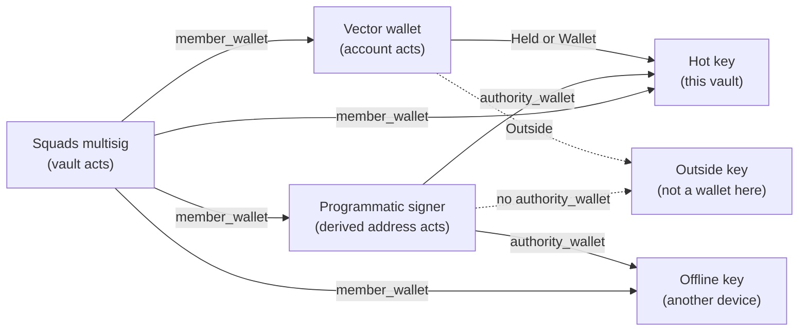

- The longest chain is Squads, then a programmatic signer or Vector wallet, then a key. A multisig cannot be a member of a multisig here.
- The fee payer is the first `fee_payer` set along the chain, starting at the wallet asked. When none is set, the key at the end pays, if this vault holds it. A fee payer must be a key: a hot wallet, or an offline wallet, whose signature then comes from the device that holds it (`WalletKind::can_pay`). The online app offers hot wallets as fee payers; Airlock Offline offers offline wallets beside them, so a key kept in the online app can pay for a wallet of the airgap device, which signs first.
- A Squads member must be in the multisig's member list, when that list was read from the chain.
- A Vector authority that is Held lives in the Vector record (not a separate hot wallet). Falcon-512 and XMSS are desktop and airgap only. Winternitz is turned off: no wallet of it is added, exported or signs ([D6](vector-fork.md#decisions)).

### Two kinds of signature

- A **transaction signature** covers the whole message. It sits in the transaction's signature slots. The first slot is the fee payer's.
- An **authorization signature** covers either a programmatic signer's `Submit` message (Ed25519, 64 bytes in instruction data) or a Vector account's digest in an `Advance` (length and place depend on the account's scheme). Both change the message, so every transaction signature made before them is removed.

`wallet_core::review::signing::sign_locally` signs in one order: every authorization this device can make (Ed25519 `Submit` slots, then Vector `Advance` slots), with a stateful Vector key (XMSS or Winternitz) last among them. A press that signs any authorization stops there. The transaction itself is signed on a later press, once none is outstanding. An authorization changes what runs: an unsigned one makes simulation fail early, so the compute it reports is far too low. Between the two presses the Sign screen simulates the authorized transaction at the highest compute limit and fits both limits to what it used. A simulation that fails leaves compute at the maximum. The browser's quick Sign is not offered when this device signs an authorization; Review does it in two presses.

### Signer states

The Sign screen lists every signer with one state (`wallet_core::review::signing::SignerState`):

| State | Meaning |
| --- | --- |
| Signed | A valid signature is in place. |
| On this device | Not signed, and this vault holds the key. |
| Needed from elsewhere | Not signed, and the key is on another device. |
| Invalid | Something is in the slot and it does not verify. |

A transaction can be submitted once every line is Signed. While an authorization is still needed from elsewhere, a local fee payer is shown as waiting rather than signable.

A multisig's wallet holds three settings: the wallet that acts as its member, the wallets that approve together with it (`approves_with`), and the durable nonce account a combined approval uses when one of them is offline (`approval_nonce`). They are set on the multisig's row on Wallets. An offline wallet approves together with others only on that durable nonce. See [Squads multisig](#squads-multisig).

`next_step` says what Sign is about to do: an *authorization* (intent) while any authority line is open, then the *outer transaction*, then nothing (Submit). The Sign button reads **Sign authorization** or **Sign transaction**. Signers with an authorization are grouped under "Authorization (intent)" and "Transaction".

### Rebuilding for a wallet without a key

A transaction that names a programmatic signer's address, a Vector account or a Squads vault as an ordinary signer cannot be completed: no key signs as those addresses. `wallet_core::wallets::adapt` rebuilds it. The plan (`plan_adaptation`) is made offline. Carrying it out (`wallet_flows::adapt::rebuild`) reads the chain for the multisig's next transaction number, the signer's executor nonce or each Vector account's data, and a fresh blockhash, so it needs a connection. The rebuild probes at the highest compute limit, then sets both the compute and loaded-accounts limits from what that simulation used plus 10%. Sign does the same again once every authorization is signed, so the inner instructions are included in the measure.

- **Programmatic signer.** The instructions move into an authorization ordered by the signer's executor nonce. A hot wallet pays and relays.
- **Several programmatic signers.** They share one authorization, with a place for each authority's signature. It is ordered by the executor nonce of one of them: the first, in the vault's order, that has a nonce account. The others need none. Each authority signs the same message, on its own device and in any order.
- **Vector wallet.** System transfers from the account become `Withdraw`. One `Advance` lists every Vector account that signs, then each run of instructions next to each other that Vector accounts sign becomes one `Passthrough` that runs as every account the run names (at most 16), whichever of them signs each instruction. A hot wallet pays and relays. The wrap's Advance/Passthrough identity is the account's Initialize key; context carries the key that verifies now.
- **Several Vector accounts.** They share one `Advance`. Each signs its own digest (message ‖ its nonce ‖ its address). Stateless schemes sign in any order; XMSS and Winternitz sign last.
- **Squads vault.** The instructions are stored as a vault transaction with the multisig's next number. The new transaction creates it and its proposal. The acting member approves it if it may vote, and executes it if one approval is enough, there is no time lock, the member may execute and the result fits in one transaction.
- **Squads with a programmatic or Vector member.** The proposal is built for the member, then wrapped in that member's authorization (Submit or Advance), in the order `adapt` already uses. The approvals are ordered so every programmatic member's instructions sit together in one `Submit` (required) and every Vector member's sit together in one `Passthrough` (when some order and executor allow it), as in `[Advance, Submit, Passthrough]`. The same order applies to a combined approval of an open proposal.

The rebuilt transaction is what gets reviewed and signed. Signatures the original carried are void.

### Transaction lifetime

A transaction built on a recent blockhash is accepted for roughly 30 to 45 seconds. A round trip through another device often takes longer.

- In Build, Advanced lets a transaction use a durable nonce instead. It then stays valid until the nonce advances.
- An offline wallet can have a durable nonce of its own, with its key as the authority (see [Offline wallet](#offline-wallet)). What that key signs for itself is compiled on it: Send, Stake and Build's default, and a site's request the key alone still has to sign.
- A programmatic signer's authorization and a Vector Advance digest have no blockhash. Before the local fee payer signs a relayed transaction, the Sign screen moves it to a fresh blockhash when it is online and nothing has signed the transaction yet. **Refresh blockhash** does the same by hand.
- A transaction a site built carries the site's blockhash. It is moved onto a durable nonce only when it waits on one offline key alone and that key's wallet has one.

The Sign screen and the browser request modal show what is being signed and how long the blockhash has left. When this app chose the blockhash (Build, rebuild, refresh), the countdown is exact from `lastValidBlockHeight`. A site's blockhash gets an estimated countdown from when the request arrived (150 blocks at about 200 ms each); Review hands the modal's estimate to the Sign screen. Both poll the node, about every 10 seconds for the height and every 5 for `isBlockhashValid`, in one shared loop (`ui::clock`). Expiry is only what the node says: the hash is no longer valid, or, for an exact countdown, the height is past `lastValidBlockHeight`; an estimate running out on wall time alone shows 0:00 without disabling anything (`wallet_core::read_clock`). Once it has expired, signing the transaction and Submit are disabled; signing an authorization is not, and neither is Sign on a relayed transaction that Sign moves to a fresh blockhash itself. A browser request on the site's blockhash cannot be refreshed: the site has to send it again. Offline, the screen says the blockhash cannot be checked.

## The pipeline

Every flow ends on the Sign screen. Other screens and the browser modal hand a transaction in through `Session::open_in_sign`, and the Sign screen's inbox takes pasted or scanned objects.

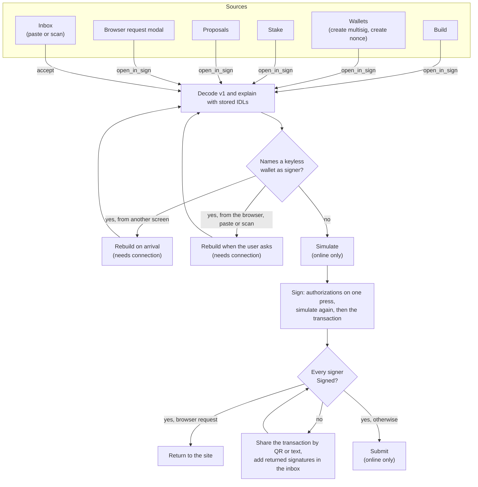

Review and Sign also has **Edit on Build**, which reads the transaction back into Build's blocks (`wallet_core::edit`): an instruction a stored IDL reads becomes that IDL's form, filled in, any other its program, accounts and hex data, and a Squads stored transaction, a Vector `Passthrough` or a programmatic `Submit` opens to the blocks it carries. Compiling there makes a new transaction, which is signed again.

What moves between devices is a QRS1 payload (`qr-protocol`): one to 64 typed objects, written with wincode. A transaction and its context note travel as one payload from Share, or each on its own. Share's Signatures tab also puts every signature in one payload, and its Everything tab sends the transaction, its note and every signature together. In a payload of several, the receiver passes over a signature the transaction on screen already holds:

| Object | Carries | Used for |
| --- | --- | --- |
| Transaction (kind 1) | The full v1 wire, with every signature it has so far | Handing the transaction to a device that signs |
| Signature (kind 2) | What it signs, then the signer and the signature: the transaction (a pubkey and 64 bytes), a Submit authorization (the authority and 64 bytes), or a Vector account authorization (the account, the nonce it was signed at, and a signature as long as the account's scheme makes it) | Bringing one signature back. The receiver puts it where it says it belongs, and verifies it there before writing it in |
| Context note (kind 3) | The message hash, the checksum of each IDL used to read it, and for each Vector account that authorizes, its scheme, nonce and leaf floor | Letting the other device compare IDLs, and sign for a Vector account. It is never signed. For a Vector transaction the note is required on Share |
| Public key (kind 4) | A scheme and a key | Handing over the next XMSS public key for a rotating wrap. Sign stores it on the matching Vector wallet. No screen makes one now: a key rotation (kind 6) replaces it |
| Key rotation (kind 6) | An account, its scheme, the next public key, and a signature of the rotation at each nonce the account may be at | Sending a rotation the airgap device signed. Sign builds the transaction around the signature made at the account's nonce. See [Rotating an XMSS key](#rotating-an-xmss-key) |
| Account state (kind 7) | An account, its scheme, its nonce, its leaf floor and the key it holds | Telling the key device what the chain says, when it has to rotate without a transaction from here: a restored wallet, or one whose nonce it has not seen. See [Recovery phrases (XMSS)](#recovery-phrases-xmss) |
| Wallet keys (kind 5) | 1 to 32 entries, each the address of a key or a Vector account's scheme and key, with its label. More keys than fit in one object are split into several | Adding wallets whose keys stay on another device. See [Moving wallets between devices](#moving-wallets-between-devices) |

A payload is at most 32 KiB, which is 43 codes. Every frame carries the same 768-byte chunk, the last one padded with zeros, so every code is QR version 23 whatever it carries. As text, a payload is JSON: one object, or an array of several, each with a `"type"`. Addresses and Ed25519 signatures are base58, SHA-256 digests and nonces are hex, and other bytes (a wire, a long key or signature, account data) are base64:

```json
{
  "type": "signature",
  "signs": "transaction",
  "pubkey": "<base58>",
  "signature": "<base58>"
}
```

The Transaction tab's text is the wire alone in base64, as other tools read one. Paste takes JSON, or a transaction alone in base64 or base58, legacy, v0 or v1. Both devices of a pair run the same build.

## Device roles

The same binary plays every role. Settings decides which.

- **Online.** Reads the chain, rebuilds, simulates, submits, and answers the browser bridge.
- **Offline (airgap).** Opens no connection. It decodes and explains the transaction with its own IDLs, signs with its own keys, and exports signatures. It cannot rebuild, simulate or submit, and it has no browser bridge.

An offline wallet record on the online device holds only the pubkey. The secret lives in the vault of the offline device, as a hot wallet there.

## Flows that start in the app

### Hot wallet

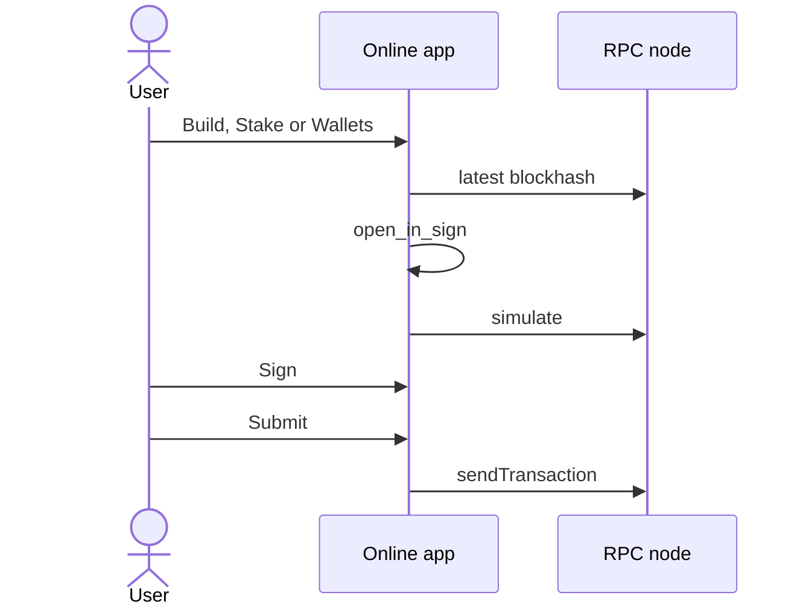

Everything happens on one device. Sign is enabled as soon as a local key has something to sign. Submit is enabled once every signer is Signed and the app is online.

### Offline wallet

The online device prepares and submits. The offline device reviews and signs.

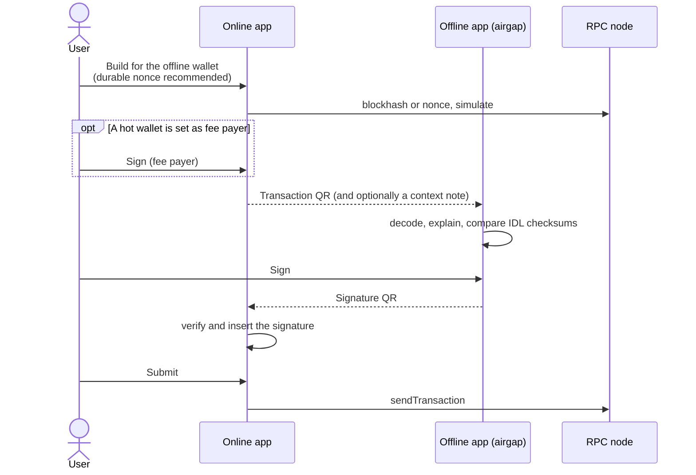

- The offline device decides on its own reading of the transaction. The context note only says which IDLs the online device used.
- Transaction signatures can be added in any order, so the fee payer may sign before or after the offline key.
- With a recent blockhash, the whole round trip has to fit in about 30 seconds. Use a durable nonce for anything slower.

#### Two paths that do not expire

An offline wallet's row offers two paths, side by side, and either can be its default:

- **Programmatic signer.** **Set up** adds the signer whose authority is this key. It is a wallet of its own, at another address (a PDA). What targets that address is rebuilt into an authorization the key signs, ordered by the signer's executor nonce. See [Programmatic signer](#programmatic-signer).
- **Durable nonce.** **Create nonce account** opens a transaction that creates a system nonce account at an address derived from the fee payer (`airlock-dn:` and the first 16 characters of the key), paid by the fee payer, with the offline key as its authority, so only that key can advance it. A transaction from the key's own address is then compiled on it: `AdvanceNonce` first, the nonce's value as its lifetime, no expiry. This path is deprecated once the programmatic signer or Vector is on mainnet.

The first path set up becomes the default, and **Make default** switches. **Use** on the row follows the default: with the programmatic signer as default it selects the signer. A default whose target is gone (the signer was removed) is cleared, and the key acts as itself on a fresh blockhash.

The nonce holds one value at a time. Two transactions made on it are both valid until one lands; the other is then void. Nothing tracks a transaction that was prepared but not sent, so the row and the Sign screen say this instead.

### Programmatic signer

Before the first use, the signer needs an executor nonce account: Wallets offers to create it, and that transaction goes through the Sign screen like any other. Rebuilding refuses a signer without one.

A screen builds instructions for the signer's derived address. The Sign screen sees that address as a signer and rebuilds the transaction as soon as it arrives. A transaction from outside the app (a browser request, or pasted or scanned text) keeps the rebuild banner instead and waits for the user to press Rebuild, so a change to something made elsewhere is never silent. Offline, or when the rebuild fails, the banner stays with its button.

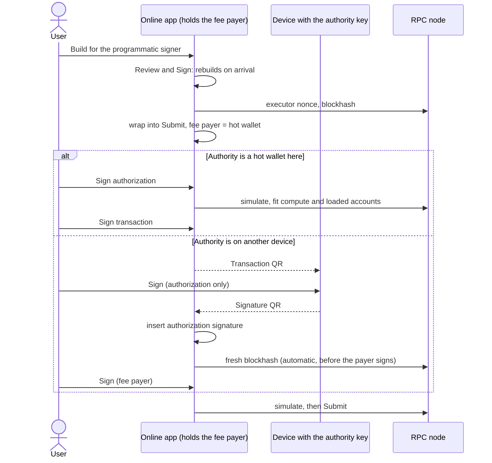

- The authority signs a message with no blockhash and no fee payer, so it can sign at any time. The executor nonce stops the same authorization from running twice.
- Simulation waits until the authorization is signed.
- The authority needs no funds. Only the fee payer does.

### Squads multisig

A screen builds instructions for the vault address. The Sign screen rebuilds them into a proposal as soon as they arrive.

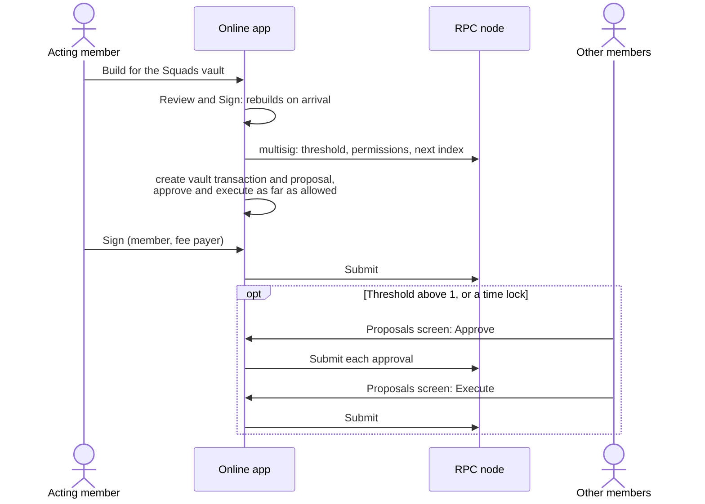

- The acting member can be a hot wallet, an offline wallet (its signature comes back by QR, as in the offline flow) or a programmatic signer (the proposal is then wrapped in its authorization, as in the programmatic flow).
- When the multisig's row names other wallets that approve together with the acting member, and a proposal still needs more than one approval that they can give, the Proposals screen also offers **Together**: one transaction that approves as each of them and executes. See [Approving together](#approving-together).
- The Proposals screen reads a page of the multisig's transactions by address, and offers Approve, Execute, or both, according to the proposal's status, the member's permissions, the threshold and the time lock. Each action compiles a fresh transaction and opens it on the Sign screen, where the same rules about the member's kind apply.
- Threshold, permissions and the next number are read from the chain, not taken from the wallet record.

#### Approving together

A device often holds wallets for several members of one multisig. Voting as each in a transaction of its own takes one trip through Sign per member, and with keys on other devices one QR round trip each, every one against its own blockhash. Together does it in one.

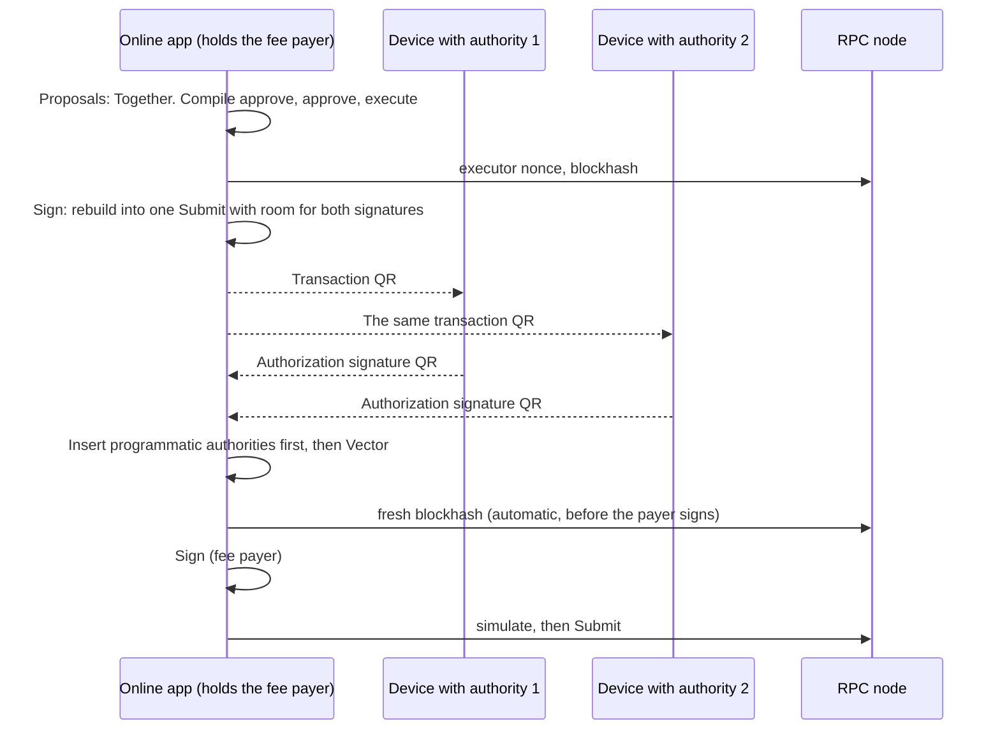

- Who votes is the row's choice, in its order: the acting member, then the wallets ticked under "Approves together with". `wallet_core::proposals::combined_approval` takes the first of them that may vote and have not, as many as the proposal still needs and no more, because the program refuses a vote past the threshold. The executor is the first voter that may execute, or else another chosen member that may.
- It is offered only when the proposal is open for votes, the stored transaction can be read here, there is no time lock and more than one approval is missing. With one missing, Approve and execute already does it.
- A member takes part when its signature cannot stall the transaction. A hot key always does. A programmatic signer always does: its authority signs an authorization with no blockhash, and the fee payer moves the transaction to a fresh one at the end. A Vector member does the same: its authority signs an Advance slot that does not cover the blockhash. An offline wallet signs the transaction itself, so it takes part only when the row names a durable nonce. The transaction then advances that nonce and stays valid until it does. Without one, the offline wallet is passed over and votes through Separate.
- Programmatic and Vector members may share one transaction: the programmatic authorities sign first (the Vector digest covers those signatures), then the Vector keys. Inserting a programmatic signature clears any Vector signature already written.
- An offline wallet and a programmatic or Vector member never share one, because the rebuild refuses a transaction on a durable nonce.
- The durable nonce's authority has to be the fee payer or one of the plain keys that vote. That is checked against the chain when the transaction is compiled (`wallet_flows::compile::compile_on_nonce`).
- A transaction on the durable nonce can be submitted by whoever holds a fully signed copy, as long as the proposal is still open and nothing else has advanced the nonce.

### Vector wallet

Turned on in Settings. The row holds an address owned by the Vector program, a scheme, and how the authority is kept: Held (material in the record), Wallet (another hot wallet of this device), or Outside (another device or a key not stored here). Creating the account on chain, or importing an existing one, is on the Wallets screen.

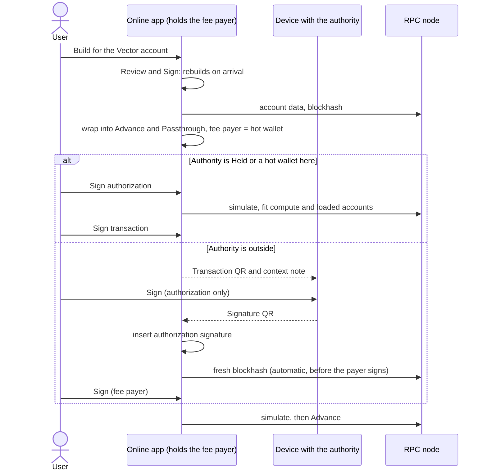

- The authority signs a digest of the top-level instructions (with message-level account flags), the account's nonce and its address. Blockhash, fee payer (unless an instruction names it) and `TransactionConfig` are not covered, so a refresh after signing still works.
- Simulation waits until every Advance slot is filled.
- Lamports leave the account through `Withdraw`. The account cannot fund `CreateAccount`.
- One outstanding signed transaction per account: a second one at the same nonce is orphaned when the first lands.
- An XMSS key has 256 leaves. Every row shows how many are left: online from the chain, and on an airgap device from its own count. Both warn at 80% used. Past 95%, a rebuild refuses anything but a rotation, and says to rotate from the device that holds the key.
- The device that holds the key rotates it: **Rotate key** on its row (see [Rotating an XMSS key](#rotating-an-xmss-key)). Online, that device sends the rotation itself. On an airgap device it shows a key rotation object (kind 6), which the online device scans or pastes on Sign and sends, paid by the wallet's fee payer.
- The device that holds the key signs a rotation only into the next key it made itself, and signs only as the key the account holds now. The next seed replaces the current one once the account is seen holding it, never before: until then the current seed is the only key that controls the account. The replaced seed stays in the record and never signs.
- Before a hash-based key signs, what it signs is recorded in `vector-leaves.json`, outside the vault: an XMSS leaf (then the record's counter in the vault), or the one digest and salt of a Winternitz key, which refuses any other digest until the account moves on. Marks belong to one key of one account, so a new key starts at its first leaf. Only an account that signs the transaction in this press records anything. An XMSS retry over the same digest reuses its leaf and salt (`XmssRetryCache`).
- A hash-based key signs last: it waits until every other account of the `Advance` has signed, or signs in the same press.
- Falcon-512 and XMSS refuse on mobile.

#### Rotating an XMSS key

A rotation is an `Advance` and nothing else. What the key signs covers the transaction's instructions, the account's nonce, its address and the next key. It does not cover the fee payer, the blockhash or the compute limits (`vector::rotation_message`). So the device that holds the key can sign one without a node, as long as it knows the nonce.

- **Where the nonce is.** Only that device signs for the account, so the account's nonce is the one it last signed at, or a digest it signed there (that digest is the nonce once it lands). Each signature records both in `vector-leaves.json` before it is made.
- **Signed at each.** **Rotate key** makes the next key when there is none, then signs the rotation once per possible nonce (up to 8), a leaf each. It records the rotation's digests first. The object carries the account, the next public key and those signatures, never a secret.
- **Sent online.** `wallet_flows::vector::rotate` reads the account, takes the signature made at its nonce, and checks it against the account's key before writing it in. A rotation made at nonces the account is no longer at is refused, and so is one that has landed. The fee payer signs, and the transaction is submitted.
- **Installed offline.** The nonce in the next context note is the rotation's digest only if that rotation landed. When the key device signs a transaction and sees that nonce, it installs the next seed first and signs with it. Online, the row installs it from the chain.
- **What a lying note can do.** A note that names a rotation's digest before the rotation lands makes the key device install the next seed too early, and what it signs then fails on chain. The seed it replaced is kept in the record (`retired_secret`) for that case. Nothing restores it from the screens yet.
- A key that has not signed anything here has no recorded nonce. Scanning the account's state (below) gives it one.
- Each press signs only at the nonces the account may be at before it moves. The rotation's own digests are where it is after, so a second press does not sign there.

#### Recovery phrases (XMSS)

An XMSS key made here comes from a 24-word recovery phrase, after Blueshift's Winterwallet (credits in [vector-fork.md](vector-fork.md#origins-and-credits)). The vault keeps the phrase and the number of the key that signs now, so every key the account will hold can be made again, and the one it holds found again. Only the words are secret: a summary shows the number and nothing else.

- **Derivation** (`wallet_core::vector::phrase_key`). The standard BIP-39 seed, then Winterwallet's hardened HMAC-SHA512 path `wallet' / parent' / child'` (child is the key's number, wallet and parent are 0) under the magic string `"Vector XMSS seed"`. The node's 32-byte key is the seed of the same ChaCha20 stream a random XMSS seed feeds. A test reproduces Winterwallet's own vector with the same code under its magic string, and a known-answer test pins ours.
- **Not the same keys as Winterwallet.** It derives the scalars of its own Winternitz key from the node; a Vector account verifies `solana-winternitz` XMSS keys. With a magic string of our own, one phrase used in both shares no node.
- **Making one.** Add wallet → Vector → XMSS → "A new key made here from a new recovery phrase" shows the words once, and asks that they were written down.
- **Rotating** moves to the phrase's next key, and installing it moves the number on. No retired seed is kept: the phrase makes it again.
- **Restoring.** "A recovery phrase written down before" makes key 0, the one the account was made with, and marks the wallet restored. A restored wallet signs nothing but a rotation, since a lost copy may have signed with leaves of the current key that never landed.
  1. On the online device, **Show account state** on the wallet's row shows an account state object (kind 7): the nonce, the leaf floor and the key the account holds now.
  2. Scanned or pasted on Sign on the key device, it finds that key among the phrase's keys (the number it holds and up to 64 past it, as Winterwallet's `recover` does), signs with it from then on, and takes the nonce and leaf floor.
  3. **Rotate key** then signs once, at that nonce, with the key's last leaf: leaves go out in rising order, so it is the one a lost copy cannot have used.
  4. Sent online like any rotation. When a later note shows it landed, the next key is installed and the wallet is whole again.
- **What the state is worth.** It is read by the online device. A wrong key or nonce makes the key device sign what fails on chain. It cannot make a leaf sign twice, and a key made from the phrase can always be made again.

#### Moving wallets between devices

A key made on the airgap device reaches the online device by its public key alone. Nothing secret is exported.

- **Export.** Each hot, offline and Vector row has **Export key**. **Export keys** on the Wallets header picks several. Both show a wallet keys object (kind 5) as a QR carousel and JSON. More keys than fit in one object are shown as parts, and each part is scanned or pasted on its own.
- **What each becomes.** A hot or offline key becomes an offline wallet on the other device, which can then set up its programmatic signer. A Vector wallet becomes a Vector wallet with its key Outside, at the same address. An Ed25519 Vector account whose key is a wallet there (or arrives in the same import) signs as that wallet.
- **Import.** **Add wallet → From another device** reads one object or several, pasted or scanned, and lists every key with its address. A key whose address is already a wallet here, or that cannot be read, is listed but cannot be ticked. The labels can be changed, and one fee payer is set for everything added.
- **Initialize on the online device.** `Initialize` needs only the key and a fee payer, never a signature from the key. It needs a recent blockhash, though, and rent from a hot wallet, so the airgap device never builds it. Its row says to export the key instead.
- Programmatic signers and multisigs are not exported. The other device sets them up from the key.

## Flows that start in a browser

Desktop only. The extension registers a Wallet Standard wallet in the page, the service worker stamps the origin from the browser, `bridge-host` relays over a per-user local socket, and the app queues the request. The extension holds no keys and decides nothing. The protocol and the threat model are in [browser-bridge.md](browser-bridge.md).

The app answers `connect` and a `signTransaction` with exactly one v1 transaction. Anything else returns `not_implemented`. A locked vault asks for the password in the modal. A request nobody answers expires after ten minutes.

### Connect

The modal lists the accounts this device can act as: wallets it holds a key for, its programmatic signers and its Squads vaults. The user ticks which ones the site may see. Only pubkeys are returned.

### The sign request modal

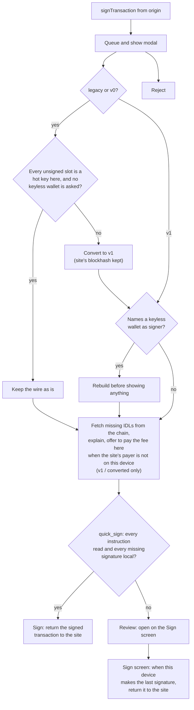

- A **legacy or v0** request is signed as is when every unsigned signature slot belongs to a hot key on this device and no programmatic signer or Squads vault is asked. A slot left for an account the transaction creates, such as a new mint, does not count: the site signs it after this device (see [Keys the site made for one transaction](#keys-the-site-made-for-one-transaction)). Otherwise it is converted to v1 (accounts inlined, site's blockhash kept); a filled signature from a key this device does not know refuses the conversion, unless it is a one-time key. The ComputeBudget instructions move into the v1 header, and the site's price per compute unit is kept. When online, the compute and loaded-accounts limits are what a simulation of the rewrite used plus 10%, even if the site filled them in; the probe asks for the highest of each (1,400,000 units and 64 MiB) so the simulation is not cut short. Offline, or when the simulation fails, the site's limits are kept when it set them, otherwise what the runtime gives a transaction that sets none (3,000 units per built-in instruction, 200,000 per other; 64 MiB of loaded account data). The notice says which.
- **Sign** is offered only when every instruction, at any depth, was put in words by an IDL that ships with the app or that the user imported, and this device can add every missing signature (`wallet_core::review::quick_sign`). An IDL read from the chain still explains its program, and the modal says so, but it leaves Review as the way forward.
- **Review** opens the transaction on the Sign screen, with simulation, Inspect and the QR handoff (v1 only; Share is hidden for an as-is legacy or v0 load).
- **Not now** folds the request into a bar at the top of the app. The request keeps waiting.
- The site always gets back the transaction that was reviewed. When that differs from what it sent, the modal and the Sign screen say so.

### Hot wallet

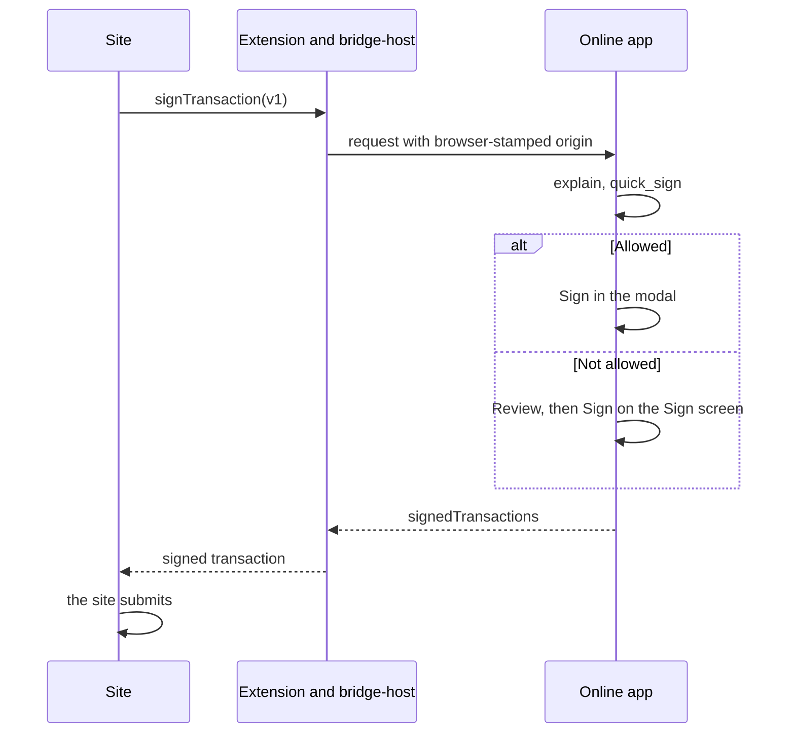

The app does not submit a transaction a site asked it to sign. The site does.

### Offline wallet

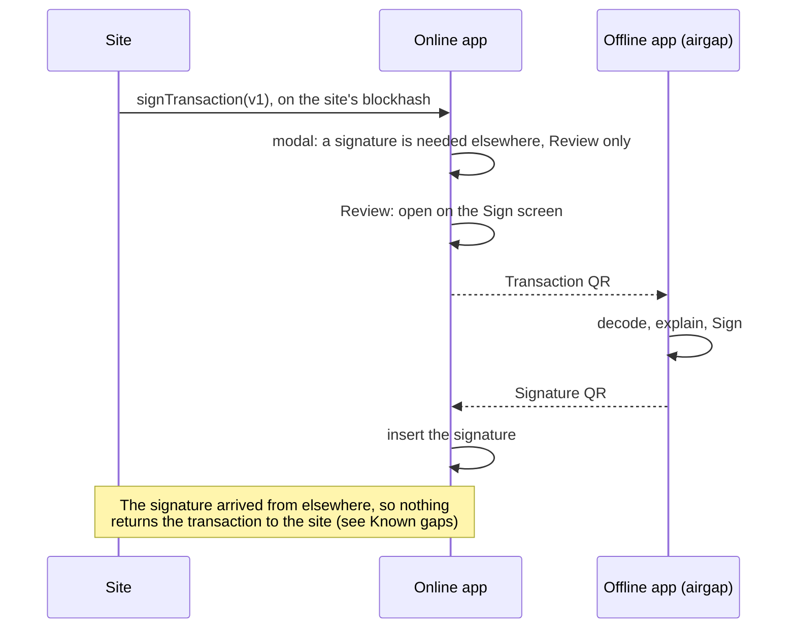

This flow is not finished:

- The transaction is returned to the site only from the local Sign action. When the offline device makes the last signature, the inserted signature completes the transaction but the request is never answered, and it expires after ten minutes. If a hot wallet of this device also signs, signing it after inserting the offline signature returns the transaction.
- The site's blockhash usually expires before a QR round trip completes. When the offline key is the only signer missing, nothing has signed yet, and its wallet has a durable nonce, the request is moved onto that nonce before review (`onto_nonce`): `AdvanceNonce` first, the same instructions, limits and fees, with room for the advance. Otherwise it stays on the site's blockhash. There is one nonce per key, not a pool, so of two requests moved onto the same nonce only the first to land is valid.

### Programmatic signer

The site was shown the signer's derived address and builds as it would for any wallet. The modal rebuilds the transaction before showing it.

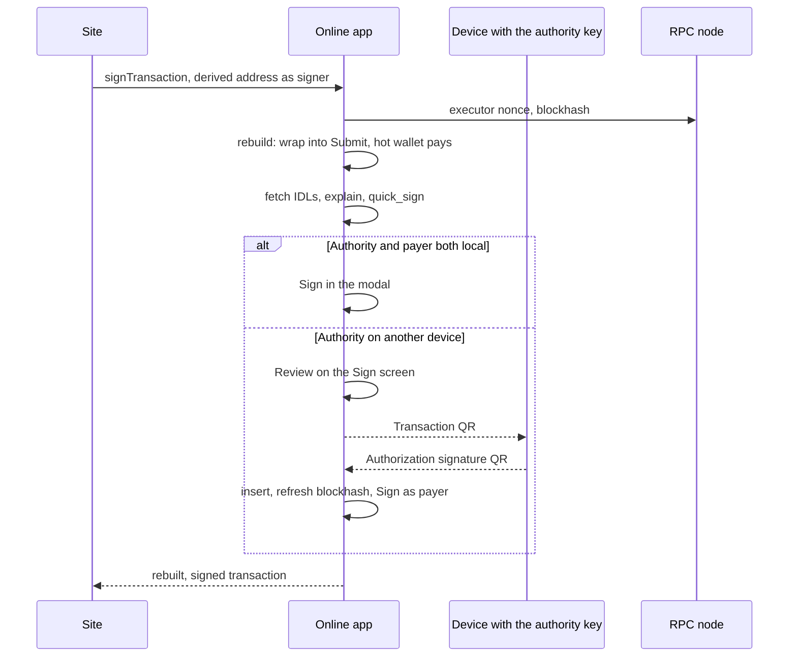

Because the local fee payer signs last, this flow does return the transaction to the site even when the authority is on another device.

### Vector wallet

Same shape as the programmatic signer: the modal rebuilds into Advance and Passthrough, a hot wallet pays, and the authority signs a digest that does not cover the blockhash. Connect lists Vector accounts only when Settings turns them on. A rotating next key that arrives as a Public key QR is stored on the Vector wallet after insert.

### Squads vault

The site was shown the vault address. The modal rebuilds the transaction into a proposal.

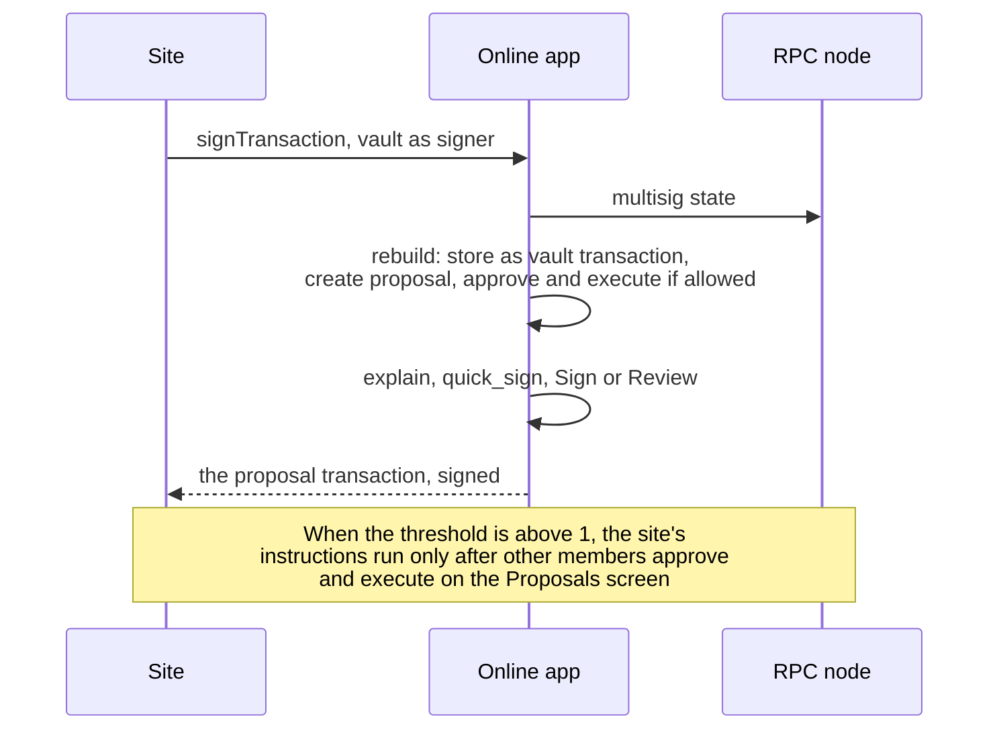

The site gets back a transaction that creates a proposal, which may not be what it expects. A threshold above 1 means the site's action has not happened when the request is answered.

### Keys the site made for one transaction

A site often makes a key for one transaction, such as a new mint, and either signs with it before sending or leaves its slot for later (`wallet_flows::request`).

- **Which accounts the transaction creates.** Each one a System `CreateAccount` makes, or an `Allocate` gives its first data (Anchor's `init` on an account that already holds lamports). The transaction's own instructions are read, and when an unsigned signer from elsewhere is not explained by them, a simulation is too: a program can create an account by keypair in its own calls, as the Whirlpool program creates a new pool's vaults. Without a node, or when that simulation fails, only the transaction's own instructions count. Preparing the request finds them once, and the modal and the Sign screen reuse that answer for the same message (`SignForm::created`).
- **Signed as sent.** When the request can be signed as is, an unsigned slot for an account the transaction creates is left to the site. Sign signs the rest and returns the transaction partly signed; the modal and the Sign screen say the site signs for its new account.
- **Replaced on conversion.** A conversion to v1 voids a signature the site made, and nobody could sign a new account's slot afterwards. So a signer that is not a wallet here, that has signed or whose account the transaction creates, and that the node has never seen in a transaction, is replaced by a key made on this device, in the accounts and in instruction data (a Token-2022 metadata pointer names the new mint). The rewrite must simulate, so it needs a connection; when it fails, the request is refused with the reason.
- The keys made here stay in memory until the app closes, and sign with the device's other keys, after any authorization. A Squads vault's stored instructions may name one besides the vault: it signs the transaction that executes the proposal, so that transaction has to create, approve and execute at once, or the rebuild is refused.
- Pasted or scanned requests have no site to sign afterwards, so they always get a key made here.

### A site that names its own fee payer

A site may name a sponsor as fee payer. Its signature has to come from elsewhere, so the request cannot be finished here. When that key only pays (no instruction names it) and is not a wallet of this device, the modal simulates the same transaction with a hot wallet paying. Only if that simulation succeeds does it offer **Pay with this wallet instead** (`wallet_core::adapt::plan_payer_swap`). Taking the offer is the user's choice, it can be undone, and the site may refuse the result. A Squads request never needs it, because its proposal is always paid from this device.

## Refusals

Rebuilding refuses, with the reason shown, when:

| Case | Why |
| --- | --- |
| The transaction advances a durable nonce | The rebuild needs a fresh blockhash. The site has to build on a recent one. |
| More than one multisig is asked to sign | A proposal belongs to one multisig. |
| Another signer is needed inside a vault's instructions, other than a key made here for a site's one-time key | A proposal can sign only as its vault. |
| No programmatic signer in the transaction has an executor nonce account, or the one used is controlled by an address that is not one of them | The authorization has nothing to order it. |
| A Vector account's data cannot be read, or its scheme does not match the wallet record | The wrap needs the on-chain scheme, nonce and verifying key. |
| The stored instructions are too large for the member's scheme even as create and propose | The rebuild produces one transaction; use a smaller intent or a buffer later. |
| A key made here for a site's one-time key is inside a vault's instructions, and the proposal cannot be created, approved and executed in one transaction | That key signs only the transaction that executes. |
| No wallet can pay | Neither address can pay its own fee. |
| The member is not in the multisig, or may not propose | Read from the chain at rebuild time. |
| A multisig is set as another multisig's member | Not supported. |
| Share of a Vector transaction without a context note | The other device needs each account's scheme, nonce and leaf floor. |
| Falcon-512 or XMSS on a mobile build | Those schemes are desktop and airgap only. |
| A Winternitz key, made here or imported | Winternitz is turned off ([D6](vector-fork.md#decisions)). |
| Anything but a rotation, from a wallet restored from its recovery phrase | A lost copy may have used leaves of its key. Scan the account state, then Rotate key. |

## Who decides

| Component | Decides |
| --- | --- |
| Site, extension, browser | Nothing. They propose transactions and report the origin. |
| Online app | Whether to sign with its own keys, and how to rebuild. For a key on another device its reading is advisory. |
| Offline app | Whether to sign with its keys, from its own decoding and its own IDLs. |
| Chain programs | Whether an authorization, a proposal approval or an execution is valid. |

A summary on either device is only as good as the IDLs it was read with. IDLs fetched from the chain were written by whoever controls the program.

## Known gaps

- **A browser request completed from another device is never answered.** See [Offline wallet](#offline-wallet-1). The fix is to return the transaction to the site whenever an inserted signature completes it, not only after a local Sign.
- **A site's blockhash outlives no QR round trip** unless the offline key has a durable nonce and is the only signer missing. A request that also waits on another outside key, or that a site already signed, stays on its blockhash.
- **Transactions prepared on one durable nonce are not tracked.** Only the first to land is valid. Nothing warns before a second is made on the same nonce.
- **A site can ask any hot wallet to sign, including ones it was never shown.** Connect grants are not remembered.
- **Not implemented:** `signAndSendTransaction`, `signMessage`, `signIn`, several transactions per request, hardware wallets.
- **Vector is on devnet only.** The program binary is not yet reproducible from this tree. See [vector-fork.md](vector-fork.md).
- **A seed replaced too early cannot be put back from the screens**, for an XMSS key not made from a phrase. It is kept in the record. No screen makes such a key now.
- A programmatic, Vector or Squads wallet without a fee payer set, whose authority or member is offline or Outside, has no payer. The review stops.

## Code map

| What | Where |
| --- | --- |
| Wallet kinds | `crates/wallet-core/src/wallets/record.rs` |
| Signing route and fee payer | `crates/wallet-core/src/wallets/route` |
| Signer states and signing order | `crates/wallet-core/src/review/signing` |
| Proposals, and approving together | `crates/wallet-core/src/wallets/proposals` |
| One-click Sign rule | `crates/wallet-core/src/review/quick_sign.rs` |
| Rebuild plans, fee payer swap | `crates/wallet-core/src/wallets/adapt` |
| Rebuild against the chain | `crates/wallet-flows/src/adapt.rs` |
| Routing a site's legacy or v0 request, one-time keys | `crates/wallet-flows/src/request.rs`, `crates/wallet-core/src/tx/convert.rs` |
| Edit on Build | `crates/wallet-core/src/edit` |
| Authorizations in a transaction | `crates/wallet-core/src/wallets/relay` (`submit` for the Ed25519 signer program; `vector` / `vector_wrap` for Advance) |
| Vector accounts: schemes, addresses, account data, instructions, the digest, XMSS/Winternitz | `crates/wallet-core/src/wallets/vector` |
| Programmatic signer instructions | `crates/wallet-core/src/wallets/programmatic` |
| Squads instructions, proposals | `crates/wallet-core/src/wallets/squads`, `crates/wallet-core/src/wallets/proposals` |
| Signature objects | `crates/wallet-core/src/transport/handoff.rs` |
| Sign screen actions | `crates/app-ui-kit/src/actions/sign_screen.rs`, `crates/app-ui-kit/src/actions/sign.rs` |
| Browser queue | `crates/app-core/src/bridge.rs` (`BridgeQueue`), `crates/app-desktop/src/bridge` (the socket) |
| Sign request modal | `crates/app-desktop/src/ui/bridge/sign_request.rs` |
